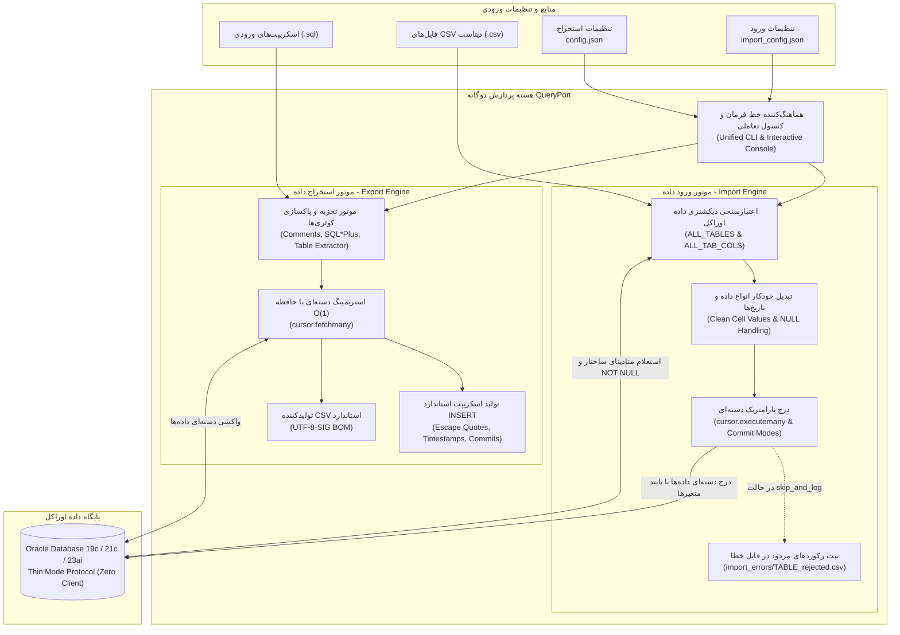

<div align="center">

# کوئری‌پورت (QueryPort)
### ابزار فوق‌سریع، سبک و مستقل استخراج و بارگذاری داده‌های پایگاه داده اوراکل (Oracle Database)
### Dual-Engine: High-Performance Oracle Exporter & CSV Importer

[](https://github.com/hamid-morsali-786/QueryPort/stargazers)
[](https://github.com/hamid-morsali-786/QueryPort/network/members)
[](LICENSE)
[](https://python.org)
[](https://oracle.github.io/python-oracledb/)
[](https://github.com/hamid-morsali-786/QueryPort/releases)
[](https://github.com/hamid-morsali-786/QueryPort/actions)
[](CONTRIBUTING.md)

<p align="center">
  <b>توسعه و نگهداری توسط:</b> <a href="https://github.com/hamid-morsali-786">hamid-morsali-786</a>
</p>

**فارسی** | [English](README.en.md)

</div>

---

<div dir="rtl">

## 📑 فهرست مطالب (Table of Contents)

- [معرفی و چرا QueryPort؟](#معرفی-و-چرا-queryport)
- [ویژگی‌های کلیدی](#ویژگیهای-کلیدی-key-features)
- [جدول مقایسه قابلیت‌ها](#جدول-مقایسه-قابلیتها)
- [معماری سیستم (Architecture)](#معماری-سیستم-architecture)
- [نصب و راه‌اندازی](#نصب-و-راهاندازی-installation)
- [شروع سریع و جریان‌های کاری خط فرمان (CLI)](#شروع-سریع-و-جریانهای-کاری-خط-فرمان-cli)
- [فایل اجرایی مستقل و کنسول تعاملی یکپارچه (Unified Interactive Console)](#فایل-اجرایی-مستقل-و-کنسول-تعاملی-یکپارچه-unified-interactive-console)
- [موتور استخراج داده‌ها (Export Engine)](#موتور-استخراج-دادهها-export-engine)
- [موتور هوشمند بارگذاری و ورود داده‌ها (CSV Importer Subsystem)](#موتور-هوشمند-بارگذاری-و-ورود-دادهها-csv-importer-subsystem)
- [راهنمای جامع فایل‌های تنظیمات (config.json و import_config.json)](#راهنمای-جامع-فایلهای-تنظیمات-configjson-و-import_configjson)
- [جدول جامع تمام پارامترهای خط فرمان (CLI Reference)](#جدول-جامع-تمام-پارامترهای-خط-فرمان-cli-reference)
- [دستورات آماده کپی و اجرا (Ready-to-Run Cheat Sheet)](#دستورات-آماده-کپی-و-اجرا-ready-to-run-cheat-sheet)
- [موتور هوشمند تفکیک و پردازش کوئری‌ها (Smart SQL Parser)](#موتور-هوشمند-تفکیک-و-پردازش-کوئریها-smart-sql-parser)
- [فرمت‌های خروجی و پشتیبانی از داده‌های فارسی (UTF-8-SIG & SQL Inserts)](#فرمتهای-خروجی-و-پشتیبانی-از-دادههای-فارسی-utf-8-sig--sql-inserts)
- [بسته آماده استقرار در محیط عملیاتی (Production Deployment)](#بسته-آماده-استقرار-در-محیط-عملیاتی-production-deployment)
- [آزمون‌ها و تضمین کیفیت (Testing & QA)](#آزمونها-و-تضمین-کیفیت-testing--qa)
- [تاریخچه ستاره‌ها (Star History)](#تاریخچه-ستارهها-star-history)
- [مشارکت و حق امتیاز](#مشارکت-و-حق-امتیاز)

---

## 🎯 معرفی و چرا QueryPort؟

در پروژه‌های سازمانی، مهاجرت داده‌ها، سیستم‌های یکپارچه‌سازی و فرآیندهای انبارش داده، دو نیاز اساسی و تکرارشونده وجود دارد:
1. **استخراج مداوم و سریع داده‌ها (Export):** تبدیل خروجی صدها کوئری پیچیده از دیتابیس اوراکل به فایل‌های استاندارد CSV یا اسکریپت‌های INSERT سازگار.
2. **ورود و بارگذاری حجیم داده‌ها (Import):** خواندن فایل‌های CSV تو در تو و بارگذاری با سرعت بسیار بالا در جداول متناظر پایگاه داده اوراکل با اعتبارسنجی ساختار، تراکنش‌های دسته‌ای و ثبت دقیق خطاهای احتمالی.

ابزارهای سنتی و متفرقه با چالش‌هایی همچون نیاز به نصب پردردسر Oracle Client/Instant Client، سرریز حافظه در حجم‌های بالا (OOM Crash)، به‌هم‌ریختگی حروف فارسی در اکسل و فقدان اعتبارسنجی پیشگیرانه مواجه هستند.

**QueryPort** یک راه‌حل جامع، سبک، دوطرفه (Export & Import) و کاملاً پرتابل است که بدون نیاز به هیچ‌گونه نصب یا پیش‌نیاز روی سرور، با درایور مستقیم **Thin Mode** اوراکل کار می‌کند.

---

## ⚡ ویژگی‌های کلیدی (Key Features)

### 🔹 قابلیت‌های مشترک و هسته مرکزی:
* 🚀 **اتصال مستقیم Thin Mode (بدون کلاینت اوراکل):** اتصال ۱۰۰٪ شبکه‌ای بدون نیاز به Oracle Instant Client، DLLهای اوراکل یا فایل `tnsnames.ora`.
* 💾 **استریمینگ بهینه با حافظه ثابت $O(1)$:** خواندن و نوشتن بلوکی رکوردها جهت جلوگیری از اشغال رم حتی در جداول چندمیلیون سطری.
* 🖥️ **کنسول تعاملی یکپارچه دو حالته:** منوی شروع هوشمند با پشتیبانی از دابل‌کلیک در ویندوز جهت انتخاب ساده بین حالت استخراج (Export) و ورود داده (Import).
* 📦 **فایل باینری مستقل و پرتابل (`QueryPort.exe`):** بدون نیاز به نصب پایتون یا هیچ وابستگی در سرور مقصد.
* 🛡️ **پشتیبانی از اسکیمای مجزا (`schema`):** امکان تغییر اسکیمای جاری سشن (`CURRENT_SCHEMA`) مستقل از نام کاربری اتصال.

### 📤 امکانات موتور استخراج داده (Export Engine):
* 📂 **سازمان‌دهی خودکار پوشه‌ها:** شناسایی نام جدول، تفکیک هر فایل اسکریپت در یک پوشه اختصاصی، و شماره‌گذاری ترتیبی خروجی‌ها.
* 🇮🇷 **سازگاری کامل با اکسل و متون فارسی:** ذخیره‌سازی فایل‌های CSV با انکودینگ استاندارد `UTF-8-SIG` (دارای BOM) برای نمایش بی‌نقص داده‌های فارسی و یونیکد در اکسل.
* 📝 **تولید اسکریپت‌های استاندارد INSERT اوراکل:** با خنثی‌سازی تک‌کوت‌ها (`''`)، درج `SET DEFINE OFF;` جهت جلوگیری از تداخل `&`، تبدیل تاریخ‌ها به توابع `TO_DATE` و `TO_TIMESTAMP` با دقت میکروثانیه، و دستور `COMMIT;`.
* 🔍 **شبیه‌سازی و شمارش رکوردها بدون ایجاد فایل (Dry-Run):** سوییچ `--dry-run` و `--confirm` برای شمارش سریع تعداد سطرهای هر کوئری در دیتابیس قبل از ایجاد فایل خروجی.

### 📥 امکانات موتور بارگذاری و ورود داده (Import Engine):
* 🔎 **اعتبارسنجی پیشگیرانه از متادیتای دیتابیس (Pre-validation Engine):**
  * کنترل قطعی وجود جدول مقصد در دیتابیس اوراکل (`ALL_TABLES`).
  * تطبیق ۱۰۰٪ نام تمام ستون‌های موجود در هدر فایل CSV با ستون‌های تعریف‌شده در جدول اوراکل (`ALL_TAB_COLS`).
  * کشف و گزارش ستون‌های با قید `NOT NULL` در جدول که در فایل CSV غایب هستند و مقدار پیش‌فرض (`DATA_DEFAULT`) ندارند؛ با توقف فوری و لغو ایمن عملیات قبل از هرگونه تغییر در دیتابیس.
* ⚡ **ورود دسته‌ای پرسرعت (Bulk Parameterized Ingestion):** استفاده از `cursor.executemany` با بایند متغیرها برای حداکثر سرعت در لایه شبکه و اوراکل.
* 🔄 **انعطاف در سیاست‌های کامیت (Commit Strategies):**
  * `batch`: کامیت بلوکی بر اساس اندازه مشخص‌شده (مثلاً هر ۵۰۰۰ سطر یکبار).
  * `row`: کامیت تک‌تک رکوردها به ازای هر سطر جهت بالاترین قابلیت اطمینان.
  * `all`: کامیت یکجای تراکنش پس از پایان کامل پردازش هر جدول.
* 🧹 **مدیریت داده‌های موجود در جداول (Existing Data Handling):**
  * `append`: الحاق به داده‌های موجود جدول.
  * `truncate`: پاکسازی کامل و فوق‌سریع جدول قبل از بارگذاری داده‌های جدید (`TRUNCATE TABLE`).
  * `skip`: نادیده گرفتن جداول دارای سطر قبلی و عبور به جدول بعدی.
* 📝 **استراتژی‌های مواجهه با خطا و لاگ رکوردهای مردود:**
  * `abort`: توقف بلادرنگ فرآیند و رول‌بک تراکنش جاری.
  * `skip_and_log`: ثبت اتوماتیک شماره سطر، علت خطا و مقادیر در پوشه `import_errors/<TABLE>_rejected.csv` و ادامه پردازش سایر سطرها.
* 📊 **گزارش آماری دقیق:** نمایش تفکیکی و تجمیعی تعداد سطرهای خوانده‌شده، وارد شده و با خطا مواجه‌شده، مدت زمان و نرخ درج بر ثانیه (rows/sec).

---

## 📊 جدول مقایسه قابلیت‌ها

| ویژگی / قابلیت | **QueryPort** | Oracle SQL Developer | اسکریپت‌های دستی پایتون | DBeaver |
| :--- | :---: | :---: | :---: | :---: |
| **عدم نیاز به نصب ابزار / پرتابل** | ✅ بله (تک‌فایل EXE) | ❌ خیر (نیاز به JDK و نصب) | ❌ خیر (نیاز به محیط پایتون) | ❌ خیر (نیاز به Java) |
| **عدم نیاز به Oracle Instant Client** | ✅ بله (Thin Mode) | ⚠️ در اکثر نسخه‌ها نیازمند است | ⚠️ وابسته به درایور cx_Oracle | ⚠️ نیازمند دانلود درایور JDBC |
| **استریمینگ با مصرف کم رم** | ✅ استریمینگ دسته‌ای | ❌ معمولاً کش در رم | ❌ غالباً `fetchall()` | ⚠️ با تنظیم دستی Fetch Size |
| **سازگاری خودکار فارسی در Excel** | ✅ پیش‌فرض (UTF-8-SIG) | ❌ دستی (نیاز به تنظیم کدپیج) | ⚠️ نیازمند تنظیم دستی کدگذاری | ❌ دستی |
| **پیش‌نمایش تعداد سطرها قبل از اجرا** | ✅ `--dry-run` و `--confirm` | ❌ خیر | ❌ خیر | ❌ خیر |
| **خروجی تمیز SQL INSERT با اسکیپ کامل** | ✅ استاندارد با `SET DEFINE OFF` | ⚠️ فرمت دستی اکسپورت | ❌ نیاز به کدنویسی طولانی | ⚠️ نیاز به تنظیم Wizard |
| **پشتیبانی از پوشه‌بندی و بچ فایل‌ها** | ✅ خودکار بر اساس نام فایل | ❌ خروجی دستی تک‌تک | ❌ نیاز به پیاده‌سازی دستی | ❌ خروجی دستی |

---

## 🏗️ معماری سیستم (Architecture)



---

## 📦 نصب و راه‌اندازی (Installation)

### ۱. استفاده از فایل اجرایی آماده (پیشنهادی برای پروداکشن)
بدون نیاز به پایتون یا درایور اوراکل، پوشه `QueryPort_Production` یا باینری `QueryPort.exe` را دریافت نموده و در کنار فایل‌های پیکربندی قرار دهید:
* `config.json` برای عملیات استخراج (Export).
* `import_config.json` برای عملیات بارگذاری (Import).

### ۲. اجرا از روی سورس‌کد پایتون (محیط توسعه)
در صورتی که می‌خواهید پروژه را در محیط پایتون اجرا و توسعه دهید:

```bash
# ۱. کلون کردن مخزن
git clone https://github.com/hamid-morsali-786/QueryPort.git
cd QueryPort

# ۲. ایجاد و فعال‌سازی محیط مجازی
python -m venv .venv

# در ویندوز:
.\.venv\Scripts\activate
# در لینوکس / مک:
source .venv/bin/activate

# ۳. نصب وابستگی‌ها
pip install -r requirements.txt
```

---

## 🚀 شروع سریع و جریان‌های کاری خط فرمان (CLI)

### اجرای تعاملی هوشمند (دابل‌کلیک یا بدون آرگومان):
```bash
QueryPort.exe
# یا با پایتون:
python export_sql.py
```

### عملیات استخراج (Export):
```bash
# استخراج سریع با تنظیمات پیش‌فرض config.json:
QueryPort.exe --mode export

# پیش‌نمایش تعداد رکوردهای فایل خاص بدون استخراج:
QueryPort.exe --path test_sql/01_CUSTOMERS_AND_ACCOUNTS.sql --dry-run

# استخراج پوشه به هر دو قالب CSV و SQL INSERT:
QueryPort.exe --path sql_queries --format both --output my_exports
```

### عملیات بارگذاری و ایمپورت (Import):
```bash
# پیش‌نمایش و اعتبارسنجی ساختار بدون درج داده (Dry-Run):
QueryPort.exe import --dry-run
# یا معادل آن:
QueryPort.exe --mode import --dry-run

# بارگذاری کلیه فایل‌های CSV با کامیت‌های دسته‌ای ۵۰۰۰ تایی:
QueryPort.exe import --path imports --commit-mode batch --batch-size 5000

# پاکسازی جداول پیش از بارگذاری و ثبت رکوردهای دارای خطا در لاگ:
QueryPort.exe import --path imports --existing-data truncate --on-error skip_and_log
```

---

## 🖱️ فایل اجرایی مستقل و کنسول تعاملی یکپارچه (Unified Interactive Console)

هنگامی که روی فایل `QueryPort.exe` دو بار کلیک می‌کنید، کنسول تعاملی هوشمند باز شده و از بسته شدن ناگهانی صفحه جلوگیری می‌کند:

```text
==================================================
           QueryPort Unified Console              
==================================================
Select Operation:
  [1 / E] : Export Database queries to CSV / SQL Insert (config.json)
  [2 / I] : Import CSV datasets into Database tables  (import_config.json)
  [exit / q] : Exit program

Enter choice [1/2] (Default: 1): 
```

* **گزینه `1` یا `E` (Export):** فرآیند استخراج با تنظیمات `config.json` را اجرا می‌کند یا با انتخاب `n` پرامپت سفارشی `QueryPort (export)>` را در اختیارتان می‌گذارد.
* **گزینه `2` یا `I` (Import):** فرآیند بارگذاری با تنظیمات `import_config.json` را آغاز کرده و یا پرامپت سفارشی `QueryPort (import)>` را برای آرگومان‌های دلخواه باز می‌نماید.

---

## 📥 موتور هوشمند بارگذاری و ورود داده‌ها (CSV Importer Subsystem)

موتور ورود داده `import_sql` به طور اختصاصی جهت ایمپورت امن، سریع و دقیق انبوه فایل‌های CSV تولیدشده به جداول اوراکل طراحی شده است.

### ۱. کشف خودکار فایل‌ها و تطبیق نام جداول
فایل‌ها می‌توانند در پوشه اصلی یا زیرپوشه‌های تودرتو قرار داشته باشند. موتور به طور خودکار پیشوندهای ترتیبی (نظیر `02_BANKPARAMETERS.csv`) را تفکیک کرده و نام خالص جدول (`BANKPARAMETERS`) را جهت تطبیق استخراج می‌کند.

### ۲. اعتبارسنجی متادیتای دیتابیس اوراکل (Data Dictionary Validation)
پیش از اجرای حتی یک دستور `INSERT` یا دستکاری جداول:
1. وجود جدول در اسکیمای هدف اوراکل بررسی می‌شود.
2. تطابق تمامی ستون‌های هدر فایل CSV با ستون‌های تعریف‌شده در جدول اوراکل ارزیابی می‌گردد.
3. در صورت وجود ستونی با قید `NOT NULL` در جدول که در فایل CSV وجود ندارد و فاقد مقدار `DATA_DEFAULT` باشد، سامانه خطای جامع صادر کرده و بلافاصله متوقف می‌شود.

### ۳. استراتژی‌های تراکنش و کامیت (Commit Strategies)
* **`batch` (پیش‌فرض):** به ازای هر $N$ سطر (مثلاً ۵,۰۰۰ رکورد)، دستور `commit` صادر می‌شود. ایده‌آل برای بهینه‌سازی منابع UNDO tablespace و جلوگیری از قفل‌های سنگین.
* **`row`:** کامیت پس از هر رکورد منفرد (بسیار دقیق با اطمینان حداکثری).
* **`all`:** یک کامیت منفرد در انتهای هر فایل/جدول.

### ۴. مدیریت رکوردهای رد شده و مواجهه با خطا
در صورت فعال بودن `--on-error skip_and_log`:
* خطاهای داده‌ای (نظیر مقادیر نامعتبر کلید خارجی یا طول فیلد) مانع از توقف کل عملیات نمی‌شوند.
* رکوردهای رد شده همراه با شماره ردیف و پیام دقیق خطای اوراکل در مسیر `import_errors/<TABLE>_rejected.csv` ثبت می‌گردند.

---

## ⚙️ راهنمای جامع فایل‌های تنظیمات (config.json و import_config.json)

### ۱. فایل تنظیمات استخراج (`config.json`)
```json
{
  "database": {
    "user": "TARGET_SCHEMA",
    "password": "your_password",
    "host": "localhost",
    "port": 1521,
    "service_name": "ORCLPDB1",
    "schema": "TARGET_SCHEMA"
  },
  "defaults": {
    "input_path": "sql_queries",
    "output_dir": "exports",
    "format": "both",
    "batch_size": 1000
  }
}
```

### ۲. فایل تنظیمات ورود داده (`import_config.json`)
```json
{
  "database": {
    "user": "TARGET_SCHEMA",
    "password": "your_password",
    "host": "localhost",
    "port": 1521,
    "service_name": "ORCLPDB1",
    "schema": "TARGET_SCHEMA"
  },
  "import_settings": {
    "input_path": "imports",
    "commit_mode": "batch",
    "batch_size": 5000,
    "existing_data_action": "append",
    "on_error": "abort",
    "bad_rows_dir": "import_errors"
  }
}
```

### جدول مشخصات تنظیمات ورود داده (`import_settings`):
| کلید | نوع | مقدار پیش‌فرض | مقادیر معتبر | توضیحات |
| :--- | :---: | :---: | :---: | :--- |
| `input_path` | رشته | `imports` | مسیر فایل یا پوشه | دایرکتوری شامل فایل‌های CSV یا آدرس یک فایل CSV |
| `commit_mode` | رشته | `batch` | `batch`, `row`, `all` | استراتژی کامیت تراکنش‌ها |
| `batch_size` | عدد | `5000` | عدد صحیح مثبت | اندازه دسته‌ها برای کامیت در حالت `batch` |
| `existing_data_action` | رشته | `append` | `append`, `truncate`, `skip` | رفتار با داده‌های فعلی جدول قبل از ورود |
| `on_error` | رشته | `abort` | `abort`, `skip_and_log` | استراتژی مواجهه با خطای سطرها |
| `bad_rows_dir` | رشته | `import_errors` | مسیر پوشه | پوشه مقصد برای ذخیره فایل‌های CSV رکوردهای خطا دار |

---

## 📋 جدول جامع تمام پارامترهای خط فرمان (CLI Reference)

### ۱. دستورات و پارامترهای موتور استخراج (Export CLI Options)
اجرا با: `QueryPort.exe [options]` یا `QueryPort.exe export [options]` یا `QueryPort.exe --mode export [options]`

| پارامتر بلند | پارامتر کوتاه | مقادیر پذیرفته‌شده | پیش‌فرض | توضیحات عملکردی |
| :--- | :---: | :---: | :---: | :--- |
| `--path` | `-p` | مسیر فایل یا فولدر | طبق کانفیگ | آدرس فایل مشخص `.sql` یا پوشه شامل چندین فایل SQL |
| `--schema` | `-s` | نام اسکیما | طبق کانفیگ | تغییر اسکیمای جاری سشن اوراکل (`CURRENT_SCHEMA`) مستقل از یوزر لاگین |
| `--format` | `-f` | `both`, `csv`, `insert` | `both` | قالب فایل‌های خروجی |
| `--dry-run` | `-d` | پرچم بدون مقدار | - | **پیش‌نمایش تعداد رکوردها:** فقط شمارش سطرها در دیتابیس بدون ساخت فایل |
| `--confirm` | - | پرچم بدون مقدار | - | **پیش‌نمایش با تایید کاربر:** نمایش تعداد رکوردها و سپس دریافت تایید برای ادامه |
| `--config` | `-c` | مسیر فایل JSON | `config.json` | آدرس فایل کانفیگ سفارشی |
| `--output` | `-o` | مسیر پوشه | `exports` | تغییر دایرکتوری ذخیره فایل‌های خروجی |
| `--batch-size` | `-b` | عدد صحیح | `1000` | تعداد سطرهای واکشی در هر پارت استریم |
| `--help` | `-h` | پرچم بدون مقدار | - | نمایش راهنمای رسمی دستورات استخراج |

### ۲. دستورات و پارامترهای موتور بارگذاری (Import CLI Options)
اجرا با: `QueryPort.exe import [options]` یا `QueryPort.exe --mode import [options]` یا `python import_sql.py [options]`

| پارامتر بلند | پارامتر کوتاه | مقادیر پذیرفته‌شده | پیش‌فرض | توضیحات عملکردی |
| :--- | :---: | :---: | :---: | :--- |
| `--path` | `-p` | مسیر فایل یا پوشه | `imports` | مسیر فایل CSV یا پوشه حاوی فایل‌های CSV جهت ورود |
| `--config` | `-c` | مسیر فایل JSON | `import_config.json` | آدرس فایل تنظیمات ایمپورت |
| `--schema` | `-s` | نام اسکیما | طبق کانفیگ | اسکیمای هدف دیتابیس اوراکل جهت اعتبارسنجی و درج |
| `--commit-mode` | - | `batch`, `row`, `all` | `batch` | استراتژی ثبت تراکنش‌ها (دسته‌ای، سطری یا پایانی) |
| `--batch-size` | `-b` | عدد صحیح مثبت | `5000` | تعداد سطرهای هر بسته جهت درج دسته‌ای و کامیت |
| `--existing-data` | - | `append`, `truncate`, `skip` | `append` | سیاست رفتار با داده‌های قبلی جدول |
| `--on-error` | - | `abort`, `skip_and_log` | `abort` | استراتژی مواجهه با خطای درج رکورد |
| `--bad-rows-dir` | - | مسیر دایرکتوری | `import_errors` | مسیر ثبت فایل‌های CSV رکوردهای خطادار مردود |
| `--dry-run` | `-d` | پرچم بدون مقدار | - | **اعتبارسنجی ساختار بدون درج داده:** بررسی جداول، ستون‌ها و Not Null |
| `--help` | `-h` | پرچم بدون مقدار | - | نمایش راهنمای رسمی دستورات ایمپورت |

---

## 💡 دستورات آماده کپی و اجرا (Ready-to-Run Cheat Sheet)

```bash
# =============================================================
# ۱. استخراج داده‌ها (Export Operations)
# =============================================================

# بررسی سریع تعداد رکوردهای فایل خاص بدون استخراج:
QueryPort.exe --path test_sql/01_CUSTOMERS_AND_ACCOUNTS.sql --dry-run

# بررسی تمام فایل‌های یک پوشه:
QueryPort.exe --path sql_queries --dry-run

# استخراج کامل (هم CSV و هم SQL INSERT):
QueryPort.exe --path sql_queries --format both

# استخراج فقط فایل‌های اکسل/CSV با پشتیبانی متن فارسی:
QueryPort.exe --path sql_queries --format csv

# استخراج با تغییر اسکیمای هدف و پوشه خروجی:
QueryPort.exe --path test_sql --schema TARGET_SCHEMA --output D:\Backups\Today

# =============================================================
# ۲. بارگذاری داده‌ها (Import Operations)
# =============================================================

# اعتبارسنجی متادیتا و بررسی سلامت بدون تغییر دیتابیس (Dry-Run):
QueryPort.exe import --dry-run

# بارگذاری یک فایل CSV مشخص:
QueryPort.exe import --path imports/02_BANKPARAMETERS.csv

# بارگذاری کلیه فایل‌های یک پوشه با کامیت ۵۰۰۰ تایی و پاکسازی جداول قبلی:
QueryPort.exe import --path imports --existing-data truncate --batch-size 5000

# بارگذاری مطمئن با کامیت سطر به سطر و ذخیره رکوردهای رد شده در لاگ:
QueryPort.exe import --commit-mode row --on-error skip_and_log

# اجرای بارگذاری روی اسکیمای مجزا:
QueryPort.exe import --schema CRM_SCHEMA --config my_import_config.json
```

---

## 🧠 موتور هوشمند تفکیک و پردازش کوئری‌ها (Smart SQL Parser)

اسکریپت‌های استخراج دیتابیس اغلب حاوی دستورات گزارش‌گیری و کامنت‌های ابزارهایی مانند SQL*Plus هستند. **QueryPort** به صورت خودکار موارد زیر را پیش از اجرا فیلتر و استانداردسازی می‌کند:

1. **حذف دستورات محیطی SQL\*Plus:** فیلتر خودکار دستورات `PROMPT`, `SET`, `SPOOL`, `CLEAR`, `SHOW` و ...
2. **پاکسازی کامنت‌ها:** حذف کامنت‌های تک‌خطی (`--`) و کامنت‌های چندخطی (`/* ... */`) حتی اگر داخل بلاک‌های پیچیده باشند.
3. **تفکیک عبارات با سمیکالن (`;`):** شکستن دستورات به صورت چند کوئری مستقل و اجرای ترتیبی هر یک با مکانیسم مدیریت خطا.
4. **استخراج هوشمند نام جدول:** شناسایی نام جدول حتی در صورت وجود پیشوند اسکیما مانند `TARGET_SCHEMA.CUSTOMER_ACCOUNTS` و نام‌گذاری خروجی با نام تمیز جدول (`CUSTOMER_ACCOUNTS`).

---

## 🔤 فرمت‌های خروجی و پشتیبانی از داده‌های فارسی

### ۱. فایل‌های CSV (Excel-Compatible)
* **انکودینگ استاندارد:** `utf-8-sig` (تزریق بایت‌های BOM در ابتدای فایل).
* باز شدن بدون هیچ‌گونه بهم‌ریختگی حروف فارسی و فونت در مایکروسافت اکسل بدون نیاز به Data Import Wizard.
* کوتینگ استاندارد فیلدهای حاوی ویرگول، انتر (Newline) و کاراکترهای خاص طبق استاندارد RFC 4180.

### ۲. اسکریپت‌های SQL INSERT (اوراکل سازگار)
* قرار دادن دستور `SET DEFINE OFF;` در خط اول فایل جهت ممانعت از توقف اجرای اسکریپت در زمان برخورد با کاراکترهای `&`.
* تبدیل امن تک‌کوت‌های داخل متن به `''`.
* تبدیل دقیق تاریخ و زمان به توابع استانداردی اوراکل:
  ```sql
  TO_DATE('2026-10-21 14:30:00', 'YYYY-MM-DD HH24:MI:SS')
  TO_TIMESTAMP('2026-10-21 14:30:00.123456', 'YYYY-MM-DD HH24:MI:SS.FF6')
  ```
* مدیریت مقادیر تهی (`NULL`) بدون ایجاد کوتیشن اضافه.
* درج اتوماتیک دستور `COMMIT;` در پایان عملیات.

---

## 🏢 بسته آماده استقرار در محیط عملیاتی (Production Deployment)

پوشه `QueryPort_Production/` شامل پکیج ایزوله و کامل جهت انتقال به سرورها و محیط‌های عملیاتی است:

```text
QueryPort_Production/
│
├── QueryPort.exe                  # فایل باینری پرتابل و بدون وابستگی
├── config.json                    # فایل تنظیمات اتصال و استخراج
├── import_config.json             # فایل تنظیمات اتصال و بارگذاری داده
├── import_config.example.json     # نمونه فایل تنظیمات بارگذاری
├── README.txt                     # راهنمای سریع متنی برای سرورها بدون مرورگر
├── README.md                      # راهنمای کامل فارسی
└── test_sql/                      # نمونه اسکریپت‌های SQL آزمایشی
```

برای استفاده در سرور، کافیست کل پوشه را روی سرور کپی نموده، اطلاعات اتصال را در `config.json` یا `import_config.json` ویرایش کرده و `QueryPort.exe` را اجرا نمایید.

---

## 🧪 آزمون‌ها و تضمین کیفیت (Testing & QA)

پروژه دارای مجموعه ۳۶ آزمون واحد (Unit Tests) جامع بر پایه استاندارد `unittest` و `pytest` است که بدون نیاز به دیتابیس لایو تمام جنبه‌های برنامه را ارزیابی می‌کند:

```bash
# اجرای کلیه تست‌ها:
pytest -v
# یا با استاندارد پایتون:
python -m unittest discover -v
```

### پوشش آزمون‌ها:
* ✅ **آزمون‌های استخراج (`test_export_sql.py` - ۲۱ تست):**
  * خواندن و اعتبارسنجی فایل تنظیمات و مدیریت خطاهای ساختاری.
  * پردازش و پالایش دستورات SQL*Plus (`PROMPT`, `SET`, `SPOOL`).
  * پاکسازی کامنت‌های تک‌خطی و چندخطی.
  * استخراج نام تمیز جدول با و بدون پیشوند اسکیما.
  * تولید خروجی CSV با BOM و انکودینگ UTF-8-SIG.
  * خنثی‌سازی و اسکیپ کاراکترهای خاص در دستورات INSERT.
  * استریمینگ کم‌مصرف حافظه با `fetchmany`.
  * منوی تعاملی و پرامپت کنسول یکپارچه.
* ✅ **آزمون‌های ورود داده (`test_import_sql.py` - ۱۵ تست):**
  * بارگذاری و اعتبارسنجی تنظیمات اختصاصی ایمپورت و پارامترهای خط فرمان.
  * کشف تو در تو فایل‌های CSV و استخراج نام خالص جدول.
  * تبدیل داده‌های سلول، تبدیل رشته‌های خالی به `None` و پارس دقیق تاریخ‌ها.
  * استریمینگ حافظه با ژنراتور دسته‌ای در مقیاس $O(1)$.
  * ارزیابی انطباق جداول، ستون‌ها و قیود NOT NULL فاقد مقدار پیش‌فرض.
  * آزمون استراتژی‌های کامیت (`batch`, `row`, `all`).
  * آزمون عملیات `truncate` و سیاست برخورد با داده‌های قبلی.
  * تفکیک و ثبت رکوردهای نامعتبر در فایل‌های لاگ خطا (`skip_and_log`).

---

## ⭐ تاریخچه ستاره‌ها (Star History)

[](https://star-history.com/#hamid-morsali-786/QueryPort&Date)

---

## 🤝 مشارکت و حق امتیاز

مشارکت شما در ارتقا و بهبود کارایی این ابزار ارزشمند است. لطفاً پیش از ارسال Pull Request موارد زیر را بررسی فرمایید:
* [راهنمای مشارکت (CONTRIBUTING.md)](CONTRIBUTING.md)
* [منشور اخلاقی (CODE_OF_CONDUCT.md)](CODE_OF_CONDUCT.md)
* [خط‌مشی امنیتی (SECURITY.md)](SECURITY.md)

### توسعه‌دهنده
طراحی و توسعه‌یافته با ❤️ توسط **[حمید مرسلی (Hamid Morsali)](https://github.com/hamid-morsali-786)**.

### لایسنس
این پروژه تحت مجوز متن‌باز **[MIT License](LICENSE)** منتشر شده است.

</div>
