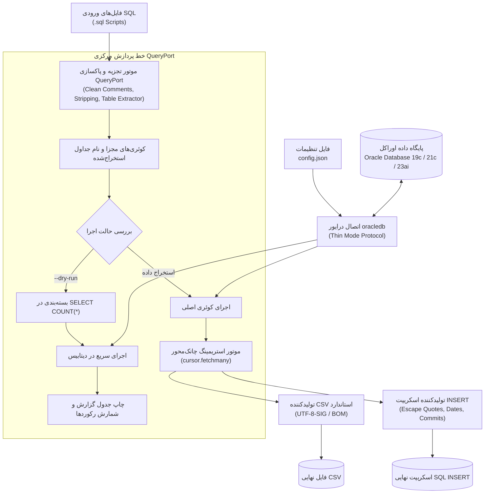

<div align="center">

# کوئری‌پورت (QueryPort)
### ابزار فوق‌سریع، سبک و مستقل استخراج و انتقال داده از پایگاه داده اوراکل (Oracle Database) به قالب‌های CSV و SQL Insert

[](https://github.com/hamid-morsali-786/QueryPort/stargazers)
[](https://github.com/hamid-morsali-786/QueryPort/network/members)
[](LICENSE)
[](https://python.org)
[](https://oracle.github.io/python-oracledb/)
[](https://github.com/hamid-morsali-786/QueryPort/releases)
[](https://github.com/hamid-morsali-786/QueryPort/actions)
[](CONTRIBUTING.md)

<p align="center">
  <b>توسعه و نگهداری توسط:</b> <a href="https://github.com/hamid-morsali-786">hamid-morsali-786</a>
</p>

**فارسی** | [English](README.en.md)

</div>

---

<div dir="rtl">

## 📑 فهرست مطالب (Table of Contents)

- [معرفی و چرا QueryPort؟](#معرفی-و-چرا-queryport)
- [ویژگی‌های کلیدی](#ویژگیهای-کلیدی-key-features)
- [جدول مقایسه قابلیت‌ها](#جدول-مقایسه-قابلیتها)
- [معماری سیستم (Architecture)](#معماری-سیستم-architecture)
- [نصب و راه‌اندازی](#نصب-و-راهاندازی-installation)
- [شروع سریع و جریان‌های کاری خط فرمان (CLI)](#شروع-سریع-و-جریانهای-کاری-خط-فرمان-cli)
- [فایل اجرایی مستقل و حالت تعاملی (Interactive Console Mode)](#فایل-اجرایی-مستقل-و-حالت-تعاملی-interactive-console-mode)
- [راهنمای جامع فایل تنظیمات (config.json)](#راهنمای-جامع-فایل-تنظیمات-configjson)
- [جدول جامع تمام پارامترهای خط فرمان (CLI Reference)](#جدول-جامع-تمام-پارامترهای-خط-فرمان-cli-reference)
- [دستورات آماده کپی و اجرا (Ready-to-Run Cheat Sheet)](#دستورات-آماده-کپی-و-اجرا-ready-to-run-cheat-sheet)
- [موتور هوشمند تفکیک و پردازش کوئری‌ها (Smart SQL Parser)](#موتور-هوشمند-تفکیک-و-پردازش-کوئریها-smart-sql-parser)
- [فرمت‌های خروجی و پشتیبانی از داده‌های فارسی (UTF-8-SIG & SQL Inserts)](#فرمتهای-خروجی-و-پشتیبانی-از-دادههای-فارسی-utf-8-sig--sql-inserts)
- [بسته آماده استقرار در محیط عملیاتی (Production Deployment)](#بسته-آماده-استقرار-در-محیط-عملیاتی-production-deployment)
- [آزمون‌ها و تضمین کیفیت (Testing & QA)](#آزمونها-و-تضمین-کیفیت-testing--qa)
- [تاریخچه ستاره‌ها (Star History)](#تاریخچه-ستارهها-star-history)
- [مشارکت و حق امتیاز](#مشارکت-و-حق-امتیاز)

---

## 🎯 معرفی و چرا QueryPort؟

در پروژه‌های سازمانی، مهاجرت داده‌ها و فرآیندهای تست و انبارش داده، نیاز به استخراج مداوم خروجی صدها کوئری پیچیده از پایگاه داده اوراکل (Oracle Database) به فرمت‌های استاندارد **CSV** یا اسکریپت‌های **SQL INSERT** همواره وجود دارد. ابزارهای رایج اداری و سنتی دارای چالش‌های اساسی هستند:

- ❌ **وابستگی به نصب سنگین کلاینت اوراکل:** ابزارهای قدیمی نیازمند نصب پردردسر Oracle Client یا Oracle Instant Client و پیکربندی فایل‌های `tnsnames.ora` و متغیرهای سیستمی هستند.
- ❌ **سرریز حافظه رم (OOM Crash):** لود کردن همزمان صدها هزار یا میلیون‌ها رکورد در حافظه، باعث متوقف شدن اسکریپت‌ها و ابزارهای گرافیکی معمولی می‌شود.
- ❌ **به‌هم‌ریختگی حروف فارسی و یونیکد در اکسل:** خروجی‌های CSV معمولی در اکسل و محیط‌های ویندوزی به دلیل عدم وجود UTF-8 BOM کاراکترها را به شکل علامت سوال یا حروف نامفهوم نمایش می‌دهند.
- ❌ **فرمت‌بندی نامناسب اسکریپت‌های INSERT:** شکستن دستورات حاوی کاراکترهای تک‌کوت (`'`)، اختلال متغیرهای جایگزین با علامت امپرسند (`&`) و ناقص ماندن تاریخ‌ها در سطح ثانیه/میکروثانیه.

**QueryPort** با هدف رفع کامل این مشکلات طراحی شده است؛ ابزاری مستقل، بدون نیاز به نصب هیچ‌گونه پیش‌نیاز روی سرور عملیاتی، مجهز به درایور رسمی **Thin Mode** اوراکل، با معماری استریمینگ بهینه حافظه و قابلیت پیش‌نمایش آنی رکوردها.

---

## ⚡ ویژگی‌های کلیدی (Key Features)

* 🚀 **اتصال مستقیم Thin Mode (بدون کلاینت اوراکل):** اتصال ۱۰۰٪ شبکه‌ای بدون نیاز به Oracle Instant Client، DLLهای اوراکل یا فایل `tnsnames.ora`.
* 💾 **استریمینگ بهینه با حافظه ثابت $O(1)$:** خواندن و نوشتن بلوکی رکوردها با متد `fetchmany` جهت جلوگیری از اشغال رم حتی در جداول چندمیلیون سطری.
* 📂 **سازمان‌دهی خودکار پوشه‌ها:** شناسایی نام جدول، تفکیک هر فایل اسکریپت در یک پوشه اختصاصی، و شماره‌گذاری خوانا و ترتیبی خروجی‌ها (مانند `01_CUSTOMERS.csv` و `01_CUSTOMERS_insert.sql`).
* 🇮🇷 **سازگاری کامل با اکسل و متون فارسی:** ذخیره‌سازی فایل‌های CSV با انکودینگ استانداردی `UTF-8-SIG` (دارای BOM) برای نمایش بی‌نقص داده‌های فارسی و یونیکد در اکسل بدون نیاز به تنظیمات ایمپورت.
* 📝 **تولید اسکریپت‌های INSERT استاندارد و سازمانی اوراکل:**
  * مدیریت استاندارد مقادیر تهی (`NULL`).
  * اسکیپ خودکار تک‌کوت‌ها (`'`) در رشته‌های متنی به `''`.
  * درج دستور `SET DEFINE OFF;` در ابتدای اسکریپت برای مهار کاراکترهای رزرو شده نظیر `&`.
  * حفظ کامل زمان و دقت میکروثانیه با توابع `TO_DATE` و `TO_TIMESTAMP(..., 'YYYY-MM-DD HH24:MI:SS.FF6')`.
  * درج عبارت پایانی `COMMIT;` جهت اعمال تراکنش.
* 🔍 **شبیه‌سازی و شمارش رکوردها بدون ایجاد فایل (Dry-Run):**
  * سوییچ `--dry-run`: شمارش سریع تعداد سطرهای هر کوئری بدون لمس حافظه یا نوشتن فایل.
  * سوییچ `--confirm`: نمایش پیش‌نمایش تعداد رکوردها و تقاضای تایید تعاملی `[y/N]` از کاربر پیش از نوشتن داده‌ها.
* 🖥️ **کنسول تعاملی برای فایل اجرایی (Interactive Console):** اجرای برنامه تنها با دابل‌کلیک در ویندوز، با قابلیت اجرای مستقیم تنظیمات، ورود دستورات سفارشی، یا خروج تمیز بدون بسته شدن ناگهانی پنجره سیاه ترمینال.
* 📦 **فایل باینری مستقل و پرتابل (`QueryPort.exe`):** بدون نیاز به نصب پایتون یا هیچ کتابخانه‌ای در سرور مقصد.

---

## 📊 جدول مقایسه قابلیت‌ها

| ویژگی / قابلیت | **QueryPort** | Oracle SQL Developer | اسکریپت‌های دستی پایتون | DBeaver |
| :--- | :---: | :---: | :---: | :---: |
| **عدم نیاز به نصب ابزار / پرتابل** | ✅ بله (تک‌فایل EXE) | ❌ خیر (نیاز به JDK و نصب) | ❌ خیر (نیاز به محیط پایتون) | ❌ خیر (نیاز به Java) |
| **عدم نیاز به Oracle Instant Client** | ✅ بله (Thin Mode) | ⚠️ در اکثر نسخه‌ها نیازمند است | ⚠️ وابسته به درایور cx_Oracle | ⚠️ نیازمند دانلود درایور JDBC |
| **استریمینگ با مصرف کم رم** | ✅ استریمینگ دسته‌ای | ❌ معمولاً کش در رم | ❌ غالباً `fetchall()` | ⚠️ با تنظیم دستی Fetch Size |
| **سازگاری خودکار فارسی در Excel** | ✅ پیش‌فرض (UTF-8-SIG) | ❌ دستی (نیاز به تنظیم کدپیج) | ⚠️ نیازمند تنظیم دستی کدگذاری | ❌ دستی |
| **پیش‌نمایش تعداد سطرها قبل از اجرا** | ✅ `--dry-run` و `--confirm` | ❌ خیر | ❌ خیر | ❌ خیر |
| **خروجی تمیز SQL INSERT با اسکیپ کامل** | ✅ استاندارد با `SET DEFINE OFF` | ⚠️ فرمت دستی اکسپورت | ❌ نیاز به کدنویسی طولانی | ⚠️ نیاز به تنظیم Wizard |
| **پشتیبانی از پوشه‌بندی و بچ فایل‌ها** | ✅ خودکار بر اساس نام فایل | ❌ خروجی دستی تک‌تک | ❌ نیاز به پیاده‌سازی دستی | ❌ خروجی دستی |

---

## 🏗️ معماری سیستم (Architecture)



---

## 📦 نصب و راه‌اندازی (Installation)

### ۱. استفاده از فایل اجرایی آماده (پیشنهادی برای پروداکشن)
بدون نیاز به پایتون یا درایور، فایل فشرده `QueryPort_Production` یا بسته `QueryPort.exe` را از بخش **[Releases](https://github.com/hamid-morsali-786/QueryPort/releases)** دانلود کرده و در کنار فایل `config.json` قرار دهید.

### ۲. اجرا از روی سورس‌کد پایتون (محیط توسعه)
در صورتی که می‌خواهید پروژه را در محیط پایتون اجرا و توسعه دهید:

```bash
# ۱. کلون کردن مخزن
git clone https://github.com/hamid-morsali-786/QueryPort.git
cd QueryPort

# ۲. ایجاد و فعال‌سازی محیط مجازی
python -m venv .venv

# در ویندوز:
.\.venv\Scripts\activate
# در لینوکس / مک:
source .venv/bin/activate

# ۳. نصب وابستگی‌ها
pip install -r requirements.txt
```

---

## 🚀 شروع سریع و جریان‌های کاری خط فرمان (CLI)

### اجرای سریع با تنظیمات پیش‌فرض:
```bash
# از طریق فایل باینری:
QueryPort.exe

# یا از طریق پایتون:
python export_sql.py
```

### استخراج یک فایل خاص به فرمت CSV:
```bash
QueryPort.exe --path test_sql/01_CUSTOMERS_AND_ACCOUNTS.sql --format csv
```

### استخراج تمامی فایل‌های یک پوشه به هر دو فرمت CSV و SQL INSERT:
```bash
QueryPort.exe --path sql_queries --format both --output my_exports
```

### پیش‌نمایش تعداد رکوردها بدون نوشتن هیچ فایلی (Dry-Run):
```bash
QueryPort.exe --path test_sql --dry-run
```

---

## 🖱️ فایل اجرایی مستقل و حالت تعاملی (Interactive Console Mode)

هنگامی که روی فایل `QueryPort.exe` دو بار کلیک می‌کنید (یا آن را در ترمینال بدون هیچ پارامتری اجرا می‌نمایید)، کنسول تعاملی هوشمند باز شده و از بسته شدن ناگهانی صفحه جلوگیری می‌کند:

```text
==================================================
      QueryPort - Interactive Console Mode        
==================================================
Options:
  [Y / Enter] : Run export with default config.json settings
  [N]         : Enter custom command mode
  [exit / q]  : Exit program

Execute with default settings? [Y/n]: 
```

* **کلید `Enter` یا `Y`:** بلافاصله عملیات را طبق تنظیمات `config.json` آغاز کرده و پس از اتمام، با پیام تایید منتظر زدن کلید جهت بستن پنجره می‌ماند.
* **کلید `N`:** پرامپت خط فرمان اختصاصی باز می‌شود:
  ```text
  Enter command or arguments (e.g. --path test_sql --dry-run).
  Type 'exit' or 'q' to quit:

  QueryPort> --path test_sql --dry-run
  QueryPort> --path sql_queries --format csv
  QueryPort> exit
  ```

---

## ⚙️ راهنمای جامع فایل تنظیمات (`config.json`)

اطلاعات اتصال به پایگاه داده و پیش‌فرض‌های اجرایی در فایل `config.json` تعریف می‌شوند:

```json
{
  "database": {
    "user": "YOUR_DB_USER",
    "password": "YOUR_DB_PASSWORD",
    "host": "localhost",
    "port": 1521,
    "service_name": "ORCLPDB1",
    "schema": "TARGET_SCHEMA"
  },
  "defaults": {
    "input_path": "sql_queries",
    "output_dir": "exports",
    "format": "both",
    "batch_size": 1000
  }
}
```

### مشخصات کلیدهای پیکربندی:
| کلید | نوع | مقدار پیش‌فرض | توضیحات |
| :--- | :---: | :---: | :--- |
| `database.user` | رشته | - | نام کاربری پایگاه داده اوراکل |
| `database.password` | رشته | - | کلمه عبور پایگاه داده |
| `database.host` | رشته | `localhost` | آدرس IP یا Hostname سرور اوراکل |
| `database.port` | عدد | `1521` | پورت شنود لیسنر اوراکل |
| `database.service_name` | رشته | `ORCL` | نام سرویس پایگاه داده (Service Name) |
| `database.schema` | رشته | اختیاری (پیش‌فرض: همان user) | **اسکیمای هدف:** تغییر اسکیمای جاری سشن (`CURRENT_SCHEMA`) جهت اجرای کوئری‌ها روی اسکیمای مجزا |
| `defaults.input_path` | رشته | `.` | پوشه یا فایل پیش‌فرض اسکریپت‌های SQL |
| `defaults.output_dir` | رشته | `exports` | مسیر پوشه مقصد ذخیره‌سازی داده‌ها |
| `defaults.format` | رشته | `both` | قالب خروجی (`both`، `csv` یا `insert`) |
| `defaults.batch_size` | عدد | `1000` | سایز واکشی چانک‌ها در حافظه برای هر نوبت واکشی |

---

## 📋 جدول جامع تمام پارامترهای خط فرمان (CLI Reference)

| پارامتر بلند | پارامتر کوتاه | مقادیر پذیرفته‌شده | توضیحات عملکردی |
| :--- | :---: | :---: | :--- |
| `--path` | `-p` | مسیر فایل یا فولدر | آدرس فایل مشخص `.sql` یا پوشه شامل چندین فایل SQL |
| `--schema` | `-s` | نام اسکیما | تغییر اسکیمای جاری سشن اوراکل (`CURRENT_SCHEMA`) مستقل از یوزر لاگین |
| `--format` | `-f` | `both`, `csv`, `insert` | قالب فایل‌های خروجی |
| `--dry-run` | `-d` | پرچم بدون مقدار | **پیش‌نمایش تعداد رکوردها:** فقط شمارش سطرها در دیتابیس بدون ساخت فایل |
| `--confirm` | - | پرچم بدون مقدار | **پیش‌نمایش با تایید کاربر:** نمایش تعداد رکوردها و سپس دریافت تایید برای ادامه |
| `--config` | `-c` | مسیر فایل JSON | آدرس فایل کانفیگ سفارشی (پیش‌فرض: `config.json`) |
| `--output` | `-o` | مسیر پوشه | تغییر دایرکتوری ذخیره فایل‌های خروجی |
| `--batch-size` | `-b` | عدد صحیح | تعداد سطرهای واکشی در هر پارت استریم |
| `--help` | `-h` | پرچم بدون مقدار | نمایش راهنمای رسمی دستورات |

---

## 💡 دستورات آماده کپی و اجرا (Ready-to-Run Cheat Sheet)

```bash
# -------------------------------------------------------------
# ۱. پیش‌نمایش و شمارش رکوردها (Dry Run)
# -------------------------------------------------------------
# بررسی سریع تعداد رکوردهای فایل خاص:
QueryPort.exe --path test_sql/01_CUSTOMERS_AND_ACCOUNTS.sql --dry-run

# بررسی تمام فایل‌های یک پوشه:
QueryPort.exe --path sql_queries --dry-run

# پیش‌نمایش رکوردها با درخواست تایید قبل از استخراج:
QueryPort.exe --path test_sql --confirm

# -------------------------------------------------------------
# ۲. استخراج به فرمت دلخواه
# -------------------------------------------------------------
# استخراج کامل (هم CSV و هم SQL INSERT):
QueryPort.exe --path sql_queries --format both

# استخراج فقط فایل‌های اکسل/CSV با پشتیبانی متن فارسی:
QueryPort.exe --path sql_queries --format csv

# استخراج فقط اسکریپت‌های INSERT جهت انتقال به دیتابیس دیگر:
QueryPort.exe --path sql_queries --format insert

# -------------------------------------------------------------
# ۳. تغییر مسیر خروجی و فایل کانفیگ
# -------------------------------------------------------------
QueryPort.exe --path test_sql --output D:\Backups\Today --config prod_config.json
```

---

## 🧠 موتور هوشمند تفکیک و پردازش کوئری‌ها (Smart SQL Parser)

اسکریپت‌های استخراج دیتابیس اغلب حاوی دستورات گزارش‌گیری و کامنت‌های ابزارهایی مانند SQL*Plus هستند. **QueryPort** به صورت خودکار موارد زیر را پیش از اجرا فیلتر و استانداردسازی می‌کند:

1. **حذف دستورات محیطی SQL\*Plus:** فیلتر خودکار دستورات `PROMPT`, `SET`, `SPOOL`, `CLEAR`, `SHOW` و ...
2. **پاکسازی کامنت‌ها:** حذف کامنت‌های تک‌خطی (`--`) و کامنت‌های چندخطی (`/* ... */`) حتی اگر داخل بلاک‌های پیچیده باشند.
3. **تفکیک عبارات با سمیکالن (`;`):** شکستن دستورات به صورت چند کوئری مستقل و اجرای ترتیبی هر یک با مکانیسم مدیریت خطا.
4. **استخراج هوشمند نام جدول:** شناسایی نام جدول حتی در صورت وجود پیشوند اسکیما مانند `TARGET_SCHEMA.CUSTOMER_ACCOUNTS` و نام‌گذاری خروجی با نام تمیز جدول (`CUSTOMER_ACCOUNTS`).

---

## 🔤 فرمت‌های خروجی و پشتیبانی از داده‌های فارسی

### ۱. فایل‌های CSV (Excel-Compatible)
* **انکودینگ استاندارد:** `utf-8-sig` (تزریق بایت‌های BOM در ابتدای فایل).
* باز شدن بدون هیچ‌گونه بهم‌ریختگی حروف فارسی و فونت در مایکروسافت اکسل بدون نیاز به Data Import Wizard.
* کوتینگ استاندارد فیلدهای حاوی ویرگول، انتر (Newline) و کاراکترهای خاص طبق استاندارد RFC 4180.

### ۲. اسکریپت‌های SQL INSERT (اوراکل سازگار)
* قرار دادن دستور `SET DEFINE OFF;` در خط اول فایل جهت ممانعت از توقف اجرای اسکریپت در زمان برخورد با کاراکترهای `&`.
* تبدیل امن تک‌کوت‌های داخل متن به `''`.
* تبدیل دقیق تاریخ و زمان به توابع استانداردی اوراکل:
  ```sql
  TO_DATE('2026-10-21 14:30:00', 'YYYY-MM-DD HH24:MI:SS')
  TO_TIMESTAMP('2026-10-21 14:30:00.123456', 'YYYY-MM-DD HH24:MI:SS.FF6')
  ```
* مدیریت مقادیر تهی (`NULL`) بدون ایجاد کوتیشن اضافه.
* درج اتوماتیک دستور `COMMIT;` در پایان عملیات.

---

## 🏢 بسته آماده استقرار در محیط عملیاتی (Production Deployment)

پوشه `QueryPort_Production/` شامل پکیج ایزوله و کامل جهت انتقال به سرورها و محیط‌های عملیاتی است:

```text
QueryPort_Production/
│
├── QueryPort.exe                  # باینری بدون وابستگی برنامه
├── config.json                    # فایل تنظیمات اتصال
├── README.txt                     # راهنمای سریع متنی برای سرورها بدون مرورگر
├── README.md                      # راهنمای کامل فارسی
└── test_sql/                      # نمونه اسکریپت‌های SQL
```

برای استفاده در سرور، کافیست کل پوشه را روی سرور کپی نموده، اطلاعات اتصال را در `config.json` ویرایش کرده و `QueryPort.exe` را اجرا نمایید.

---

## 🧪 آزمون‌ها و تضمین کیفیت (Testing & QA)

پروژه دارای مجموعه کامل تست‌های واحد بر پایه استاندارد `unittest` و `pytest` است که بدون نیاز به دیتابیس لایو (با بهره‌گیری از تکنیک‌های Mocking پیشرفته) تمام جنبه‌های برنامه را ارزیابی می‌کند:

```bash
# اجرای تست‌ها:
pytest -v
# یا:
python -m unittest test_export_sql.py
```

### پوشش آزمون‌ها:
* ✅ خواندن و اعتبارسنجی فایل تنظیمات و خطاهای پیکربندی نامعتبر.
* ✅ پردازش و نادیده گرفتن دستورات SQL*Plus (`PROMPT`, `SET`, `SPOOL`).
* ✅ پاکسازی کامنت‌های تک‌خطی و چندخطی.
* ✅ استخراج نام تمیز جدول از کوئری‌های تک‌جدولی و چندجدولی با پیشوند اسکیما.
* ✅ تولید فایل‌های CSV با بایت‌های BOM و انکودینگ UTF-8-SIG.
* ✅ فرمت‌بندی رشته‌های INSERT، اسکیپ کوت‌ها، اعداد، نال‌ها و تاریخ/تایم‌استمپ.
* ✅ اعتبارسنجی استریمینگ چانک‌ها با `fetchmany`.
* ✅ عملکرد صحیح حالت‌های تعاملی کنسول و مدیریت پرامپت‌ها.

---

## ⭐ تاریخچه ستاره‌ها (Star History)

[](https://star-history.com/#hamid-morsali-786/QueryPort&Date)

---

## 🤝 مشارکت و حق امتیاز

مشارکت شما در ارتقا و بهبود کارایی این ابزار ارزشمند است. لطفاً پیش از ارسال Pull Request موارد زیر را بررسی فرمایید:
* [راهنمای مشارکت (CONTRIBUTING.md)](CONTRIBUTING.md)
* [منشور اخلاقی (CODE_OF_CONDUCT.md)](CODE_OF_CONDUCT.md)
* [خط‌مشی امنیتی (SECURITY.md)](SECURITY.md)

### توسعه‌دهنده
طراحی و توسعه‌یافته با ❤️ توسط **[حمید مرسلی (Hamid Morsali)](https://github.com/hamid-morsali-786)**.

### لایسنس
این پروژه تحت مجوز متن‌باز **[MIT License](LICENSE)** منتشر شده است.

</div>
