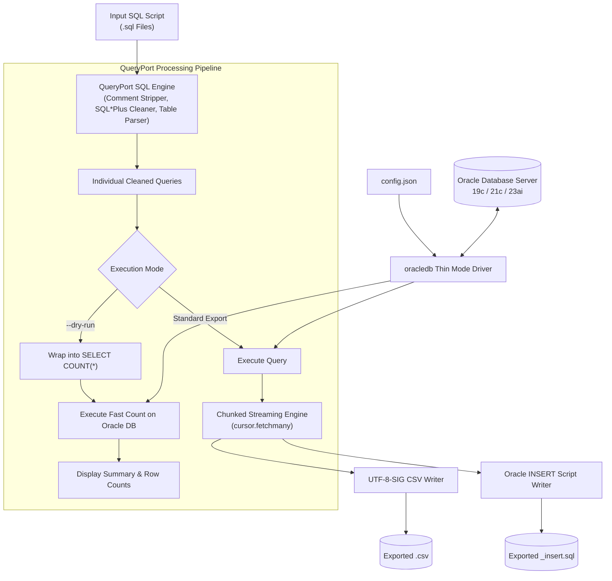

<div align="center">

# QueryPort
### Ultra-fast, lightweight, and standalone data export utility for Oracle Database to CSV and SQL Insert formats

[](https://github.com/hamid-morsali-786/QueryPort/stargazers)
[](https://github.com/hamid-morsali-786/QueryPort/network/members)
[](LICENSE)
[](https://python.org)
[](https://oracle.github.io/python-oracledb/)
[](https://github.com/hamid-morsali-786/QueryPort/releases)
[](https://github.com/hamid-morsali-786/QueryPort/actions)
[](CONTRIBUTING.md)

<p align="center">
  <b>Developed & Maintained by:</b> <a href="https://github.com/hamid-morsali-786">hamid-morsali-786</a>
</p>

[فارسی](README.md) | **English**

</div>

---

## 📑 Table of Contents

- [Introduction & Why QueryPort?](#-introduction--why-queryport)
- [Key Features](#-key-features)
- [Feature Comparison Matrix](#-feature-comparison-matrix)
- [System Architecture](#-system-architecture)
- [Installation & Quick Start](#-installation--quick-start)
- [Standalone Portable Executable](#-standalone-portable-executable)
- [Interactive Console Mode](#-interactive-console-mode)
- [Configuration Guide (config.json)](#-configuration-guide-configjson)
- [CLI Reference](#-cli-reference)
- [Ready-to-Run Cheat Sheet](#-ready-to-run-cheat-sheet)
- [Testing & Quality Assurance](#-testing--quality-assurance)
- [License & Contributing](#-license--contributing)

---

## 🎯 Introduction & Why QueryPort?

In enterprise environments, data migrations, testing, and analytics pipelines, database administrators and engineers frequently extract datasets from Oracle Database to **CSV** and **SQL INSERT** scripts. Traditional workflows suffer from major pain points:

- ❌ **Heavy Client Dependencies:** Traditional tools require cumbersome Oracle Client / Oracle Instant Client installations, environment variables, and `tnsnames.ora` setup.
- ❌ **Memory Out-of-Memory (OOM) Crashes:** Loading millions of rows into memory using naive `fetchall()` approaches crashes processes.
- ❌ **Corrupted Multilingual / RTL Characters in Excel:** CSV exports often miss UTF-8 BOM, causing Excel to mangle Persian, Arabic, and Unicode text.
- ❌ **Broken SQL INSERT Scripts:** Quoting issues, substitution variable errors (`&`), missing `SET DEFINE OFF`, and truncated timestamps.

**QueryPort** is built to solve all of these challenges. It requires **zero Oracle Client installation**, connects directly via Oracle's native **Thin Mode**, streams queries in chunked buffers with constant memory $O(1)$, and comes with an interactive console and portable binary.

---

## ⚡ Key Features

* 🚀 **Zero Oracle Client (Thin Mode):** 100% direct TCP/IP network connection via `python-oracledb`. No Oracle Instant Client or DLLs needed.
* 💾 **Constant Memory Streaming $O(1)$:** Streams rows using `fetchmany` to handle millions of rows without RAM pressure.
* 📂 **Automatic Folder & Query Organization:** Parses `.sql` scripts, isolates multiple queries, extracts clean table names, and numbers files sequentially.
* 🌐 **Excel-Ready UTF-8-SIG (BOM):** Flawless Persian, Arabic, and Unicode character rendering in Microsoft Excel without import wizards.
* 📝 **Production-Grade Oracle INSERT Scripts:**
  - Handles `NULL` literals cleanly.
  - Escapes single quotes (`'`) to `''`.
  - Injects `SET DEFINE OFF;` to bypass SQL*Plus ampersand (`&`) variable prompts.
  - Preserves sub-second timestamps (`TO_TIMESTAMP(..., 'YYYY-MM-DD HH24:MI:SS.FF6')`).
  - Appends `COMMIT;` statements.
* 🔍 **Pre-execution Row Count Preview (Dry Run):**
  - `--dry-run`: Counts rows quickly with `SELECT COUNT(*)` wrapper without creating disk files.
  - `--confirm`: Previews row counts and asks for interactive confirmation `[y/N]` before writing.
* 🖥️ **Interactive Windows Console:** Double-click support for Windows without sudden terminal closing.

---

## 📊 Feature Comparison Matrix

| Feature | **QueryPort** | Oracle SQL Developer | Custom Python Script | DBeaver |
| :--- | :---: | :---: | :---: | :---: |
| **Zero Installation / Portable EXE** | ✅ Yes (Single binary) | ❌ No (Requires JDK) | ❌ No (Requires Python env) | ❌ No (Requires Java) |
| **No Oracle Client / Instant Client** | ✅ Yes (Thin Mode) | ⚠️ Usually needed | ⚠️ Deprecating cx_Oracle | ⚠️ Needs JDBC jar |
| **Low Memory Streaming** | ✅ Batch streaming | ❌ High memory usage | ❌ Usually `fetchall()` | ⚠️ Manual Fetch Size |
| **Automatic Persian / Unicode Excel BOM**| ✅ UTF-8-SIG by default | ❌ Manual codepage | ⚠️ Requires custom logic | ❌ Manual |
| **Pre-execution Row Count Preview** | ✅ `--dry-run` & `--confirm` | ❌ No | ❌ No | ❌ No |
| **Oracle INSERT with `SET DEFINE OFF`** | ✅ Automated | ⚠️ Manual export | ❌ Needs custom builder | ⚠️ Wizard dependent |

---

## 🏗️ System Architecture



---

## 📦 Installation & Quick Start

### 1. Standalone Binary (Recommended for Production)
Download the latest portable release from **[Releases](https://github.com/hamid-morsali-786/QueryPort/releases)**, configure `config.json`, and run `QueryPort.exe`.

### 2. From Source (Development)
```bash
git clone https://github.com/hamid-morsali-786/QueryPort.git
cd QueryPort

python -m venv .venv
.\.venv\Scripts\activate   # Windows
source .venv/bin/activate  # Linux / macOS

pip install -r requirements.txt
```

---

## 🚀 CLI Reference

| Option | Short | Arguments | Description |
| :--- | :---: | :---: | :--- |
| `--path` | `-p` | Path | Path to a single `.sql` file or directory of `.sql` files |
| `--format` | `-f` | `both`, `csv`, `insert` | Output format (default: `both`) |
| `--dry-run` | `-d` | Flag | Preview row counts without writing any files |
| `--confirm` | - | Flag | Preview row counts and prompt for confirmation before export |
| `--config` | `-c` | Path | Path to configuration file (default: `config.json`) |
| `--output` | `-o` | Path | Output directory for exported files |
| `--batch-size` | `-b` | Integer | Streaming buffer size (default: `1000`) |
| `--help` | `-h` | Flag | Show command-line help |

---

## 💡 Ready-to-Run Cheat Sheet

```bash
# Preview row counts without exporting:
QueryPort.exe --path test_sql --dry-run

# Preview and confirm before running:
QueryPort.exe --path test_sql --confirm

# Export to both CSV and SQL INSERT:
QueryPort.exe --path sql_queries --format both

# Export to CSV only (Excel-friendly UTF-8 BOM):
QueryPort.exe --path sql_queries --format csv

# Custom output directory:
QueryPort.exe --path test_sql --output D:\Backups\Exported
```

---

## 🧪 Testing & Quality Assurance

QueryPort includes a comprehensive mock-based test suite that validates parsing, formatting, escaping, and streaming without requiring a live Oracle server:

```bash
pytest -v
# or
python -m unittest test_export_sql.py
```

---

## 🤝 Contributing & License

Contributions are welcome! Please review:
* [Contributing Guidelines](CONTRIBUTING.md)
* [Code of Conduct](CODE_OF_CONDUCT.md)
* [Security Policy](SECURITY.md)

### Author
Developed with ❤️ by **[Hamid Morsali](https://github.com/hamid-morsali-786)**.

### License
Released under the **[MIT License](LICENSE)**.
