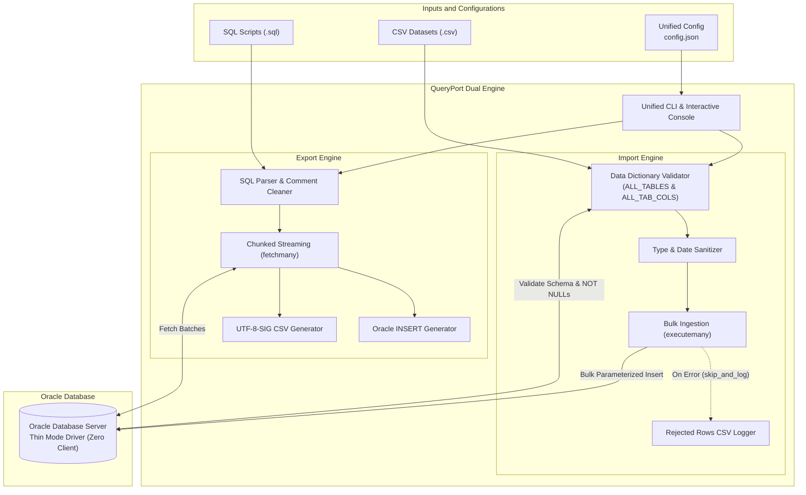

<div align="center">

# QueryPort
### High-performance, lightweight, and standalone bidirectional data engine for Oracle Database: SQL Exporter & Bulk CSV Importer

[](https://github.com/hamid-morsali-786/QueryPort/stargazers)
[](https://github.com/hamid-morsali-786/QueryPort/network/members)
[](LICENSE)
[](https://python.org)
[](https://oracle.github.io/python-oracledb/)
[](https://github.com/hamid-morsali-786/QueryPort/releases)
[](https://github.com/hamid-morsali-786/QueryPort/actions)
[](CONTRIBUTING.md)

<p align="center">
  <b>Developed & Maintained by:</b> <a href="https://github.com/hamid-morsali-786">hamid-morsali-786</a>
</p>

[فارسی](README.md) | **English**

</div>

---

## 📑 Table of Contents

- [Introduction & Why QueryPort?](#-introduction--why-queryport)
- [Key Features](#-key-features)
- [Feature Comparison Matrix](#-feature-comparison-matrix)
- [System Architecture](#-system-architecture)
- [Installation & Quick Start](#-installation--quick-start)
- [Unified Interactive Console Mode](#-unified-interactive-console-mode)
- [CSV Importer Subsystem](#-csv-importer-subsystem)
- [Configuration Guides (config.json & import_config.json)](#-configuration-guides)
- [CLI Reference](#-cli-reference)
- [Ready-to-Run Cheat Sheet](#-ready-to-run-cheat-sheet)
- [Testing & Quality Assurance](#-testing--quality-assurance)
- [License & Contributing](#-license--contributing)

---

## 🎯 Introduction & Why QueryPort?

In enterprise data migrations, testing pipelines, and cross-system integration, database administrators and engineers frequently face two symmetrical challenges:
1. **Bulk Data Extraction (Export):** Exporting results of complex queries from Oracle Database to Excel-friendly CSV and production-ready SQL INSERT scripts.
2. **Bulk Data Ingestion (Import):** Loading large CSV datasets into Oracle Database tables with strict pre-execution schema validation, flexible transaction commits, and error logging.

Traditional tools often mandate heavy Oracle Client / Instant Client installations, crash on large datasets due to memory leaks, corrupt Persian/Arabic/Unicode text in Excel, or fail silently during imports without validating required constraints.

**QueryPort** is a zero-dependency, portable bidirectional utility powered directly by Oracle's official **Thin Mode** driver. It delivers constant memory streaming $O(1)$, comprehensive data dictionary pre-validation, and an intuitive double-click interactive Windows console.

---

## ⚡ Key Features

### 🔹 Core Capabilities:
* 🚀 **Zero Oracle Client (Thin Mode):** 100% direct TCP/IP network connection via `python-oracledb`. No Instant Client, DLLs, or `tnsnames.ora` required.
* 💾 **Constant Memory Streaming $O(1)$:** Streams batches in chunks to process millions of rows without RAM pressure.
* 🛡️ **Schema Decoupling (`schema`):** Switch `CURRENT_SCHEMA` independently of the authentication user.
* 🖥️ **Unified Interactive Windows Console:** Double-click support for Windows without sudden terminal closing, offering easy selection between Export and Import workflows.
* 📦 **Portable Standalone Binary (`QueryPort.exe`):** Single executable ready for production servers without Python installed.

### 📤 Export Engine:
* 📂 **Automatic Folder & Query Organization:** Parses `.sql` scripts, isolates multiple queries, extracts clean table names, and numbers files sequentially.
* 🌐 **Excel-Ready UTF-8-SIG (BOM):** Flawless Persian, Arabic, and Unicode character rendering in Microsoft Excel without import wizards.
* 📝 **Production-Grade Oracle INSERT Scripts:**
  - Handles `NULL` literals cleanly.
  - Escapes single quotes (`'`) to `''`.
  - Injects `SET DEFINE OFF;` to bypass SQL*Plus ampersand (`&`) prompts.
  - Preserves sub-second timestamps (`TO_TIMESTAMP(..., 'YYYY-MM-DD HH24:MI:SS.FF6')`).
  - Appends `COMMIT;` statements.
* 🔍 **Pre-execution Row Count Preview (Dry Run):**
  - `--dry-run`: Counts rows quickly with `SELECT COUNT(*)` wrapper without creating disk files.
  - `--confirm`: Previews row counts and asks for interactive confirmation `[y/N]` before writing.

### 📥 Import Engine:
* 🔎 **Oracle Data Dictionary Pre-Validation:**
  - Validates table existence in target schema (`ALL_TABLES`).
  - Verifies 100% of CSV headers exist as columns in the Oracle table (`ALL_TAB_COLS`).
  - Detects `NOT NULL` columns missing from the CSV that lack a `DATA_DEFAULT`, aborting before any data is modified.
* ⚡ **Bulk Parameterized Ingestion:** High-speed `cursor.executemany` with bound variables.
* 🔄 **Flexible Commit Strategies:** `batch` (e.g. every 5,000 rows), `row` (row-by-row), or `all` (single commit per table).
* 🧹 **Existing Data Management:** `append`, `truncate` (`TRUNCATE TABLE`), or `skip`.
* 📝 **Resilient Error Logging:** Optional `skip_and_log` mode saves rejected rows with line numbers and Oracle error messages to `import_errors/<TABLE>_rejected.csv`.
* 📊 **Summary Metrics:** Execution duration, records imported, failed, and ingestion rate (rows/sec).

---

## 📊 Feature Comparison Matrix

| Feature | **QueryPort** | Oracle SQL Developer | Custom Python Script | DBeaver |
| :--- | :---: | :---: | :---: | :---: |
| **Zero Installation / Portable EXE** | ✅ Yes (Single binary) | ❌ No (Requires JDK) | ❌ No (Requires Python env) | ❌ No (Requires Java) |
| **No Oracle Client / Instant Client** | ✅ Yes (Thin Mode) | ⚠️ Usually needed | ⚠️ Deprecating cx_Oracle | ⚠️ Needs JDBC jar |
| **Low Memory Streaming** | ✅ Batch streaming | ❌ High memory usage | ❌ Usually `fetchall()` | ⚠️ Manual Fetch Size |
| **Automatic Unicode / Excel BOM** | ✅ UTF-8-SIG by default | ❌ Manual codepage | ⚠️ Requires custom logic | ❌ Manual |
| **Data Dictionary Pre-Validation** | ✅ Strict pre-check | ❌ During import | ❌ Rare | ⚠️ Basic |
| **Commit Modes (Batch / Row / All)** | ✅ Configurable | ⚠️ Limited | ❌ Needs custom code | ⚠️ Limited |
| **Bad-Row CSV Error Export** | ✅ Built-in | ⚠️ Manual review | ❌ Needs custom logging | ⚠️ Manual review |

---

## 🏗️ System Architecture



---

## 📦 Installation & Quick Start

### 1. Standalone Binary (Recommended for Production)
Download the latest portable release from **[Releases](https://github.com/hamid-morsali-786/QueryPort/releases)**, configure `config.json`, and run `QueryPort.exe`.

### 2. From Source (Development)
```bash
git clone https://github.com/hamid-morsali-786/QueryPort.git
cd QueryPort

python -m venv .venv
.\.venv\Scripts\activate   # Windows
source .venv/bin/activate  # Linux / macOS

pip install -r requirements.txt
```

---

## 🖱️ Unified Interactive Console Mode

When launching `QueryPort.exe` without arguments (e.g. double-clicking):

```text
==================================================
           QueryPort Unified Console              
==================================================
Select Operation:
  [1 / E] : Export Database queries to CSV / SQL Insert (config.json)
  [2 / I] : Import CSV datasets into Database tables  (config.json)
  [exit / q] : Exit program

Enter choice [1/2] (Default: 1): 
```

---

## ⚙️ Configuration Guide (`config.json`)

All database connection parameters, export options, and bulk import settings are unified into a single `config.json`:

```json
{
  "database": {
    "user": "YOUR_DB_USER",
    "password": "YOUR_DB_PASSWORD",
    "host": "localhost",
    "port": 1521,
    "service_name": "ORCLPDB1",
    "schema": "TARGET_SCHEMA"
  },
  "export": {
    "input_path": "sql_queries",
    "output_dir": "exports",
    "format": "both",
    "batch_size": 1000
  },
  "import": {
    "input_path": "imports",
    "commit_mode": "batch",
    "batch_size": 5000,
    "existing_data_action": "append",
    "on_error": "abort",
    "bad_rows_dir": "import_errors"
  }
}
```

> [!NOTE]
> Backward compatibility is fully preserved: legacy section keys (`"defaults"`, `"import_settings"`) and separate files continue to work without changes.

---

## 🚀 CLI Reference

### 1. Export CLI Options
Usage: `QueryPort.exe [options]` or `QueryPort.exe --mode export [options]`

| Option | Short | Type | Default | Description |
| :--- | :---: | :---: | :---: | :--- |
| `--path` | `-p` | Path | from config | Path to a single `.sql` file or directory |
| `--schema` | `-s` | String | from config | Switch session `CURRENT_SCHEMA` |
| `--format` | `-f` | String | `both` | Output format (`both`, `csv`, `insert`) |
| `--dry-run` | `-d` | Flag | - | Row count preview without disk writes |
| `--confirm` | - | Flag | - | Preview row counts with confirmation prompt |
| `--config` | `-c` | Path | `config.json` | Path to export config file |
| `--output` | `-o` | Path | `exports` | Output directory |
| `--batch-size` | `-b` | Int | `1000` | Stream fetch buffer size |

### 2. Import CLI Options
Usage: `QueryPort.exe import [options]` or `QueryPort.exe --mode import [options]`

| Option | Short | Type | Default | Description |
| :--- | :---: | :---: | :---: | :--- |
| `--path` | `-p` | Path | `imports` | Path to CSV file or directory of CSV files |
| `--config` | `-c` | Path | `config.json` | Path to config file (unified or legacy) |
| `--schema` | `-s` | String | from config | Target Oracle database schema |
| `--commit-mode` | - | String | `batch` | Commit strategy: `batch`, `row`, `all` |
| `--batch-size` | `-b` | Int | `5000` | Batch size for ingestion and commits |
| `--existing-data` | - | String | `append` | Existing table data action: `append`, `truncate`, `skip` |
| `--on-error` | - | String | `abort` | Error strategy: `abort`, `skip_and_log` |
| `--bad-rows-dir` | - | Path | `import_errors` | Directory for rejected row CSV logs |
| `--dry-run` | `-d` | Flag | - | Pre-validate metadata without writing data |

---

## 💡 Ready-to-Run Cheat Sheet

```bash
# -------------------------------------------------------------
# Export Operations
# -------------------------------------------------------------
# Preview row counts without exporting:
QueryPort.exe --path test_sql --dry-run

# Export to both CSV and SQL INSERT:
QueryPort.exe --path sql_queries --format both

# -------------------------------------------------------------
# Import Operations
# -------------------------------------------------------------
# Pre-validate CSV datasets against Oracle metadata:
QueryPort.exe import --dry-run

# Import with batch commits of 5000 rows and truncate existing data:
QueryPort.exe import --path imports --existing-data truncate --batch-size 5000

# Import with row-by-row commit and error logging:
QueryPort.exe import --commit-mode row --on-error skip_and_log
```

---

## 🧪 Testing & Quality Assurance

QueryPort includes a comprehensive mock-based test suite of 39 unit tests validating all components without needing external test runners or a live Oracle database:

```bash
python -m unittest discover -v
```

* `test_export_sql.py` (21 tests): SQL parsing, comments, escaping, UTF-8-SIG BOM, streaming, and CLI routing.
* `test_import_sql.py` (18 tests): File discovery, cell cleaning, native date parsing (`fromisoformat`), data dictionary validation, commit modes, and bad-row logging.

---

## 🤝 Contributing & License

Contributions are welcome! Please review [CONTRIBUTING.md](CONTRIBUTING.md) and [CODE_OF_CONDUCT.md](CODE_OF_CONDUCT.md).

### Author
Developed with ❤️ by **[Hamid Morsali](https://github.com/hamid-morsali-786)**.

### License
Released under the **[MIT License](LICENSE)**.
