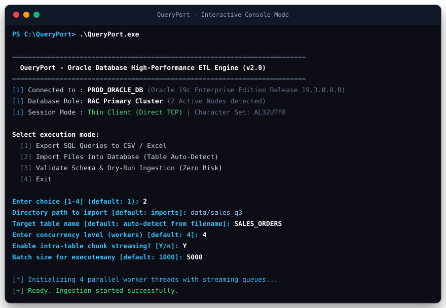
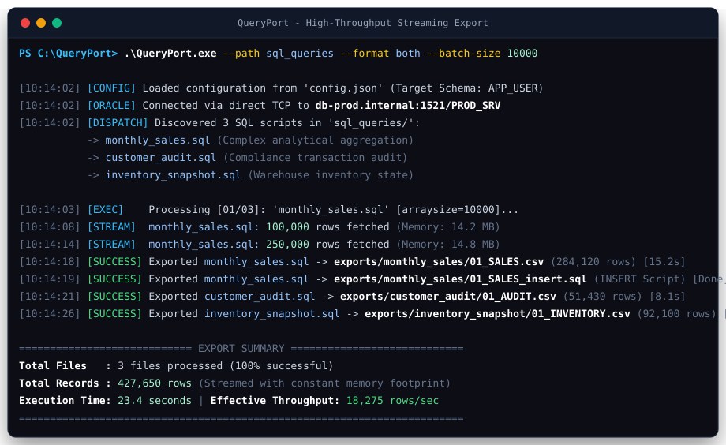
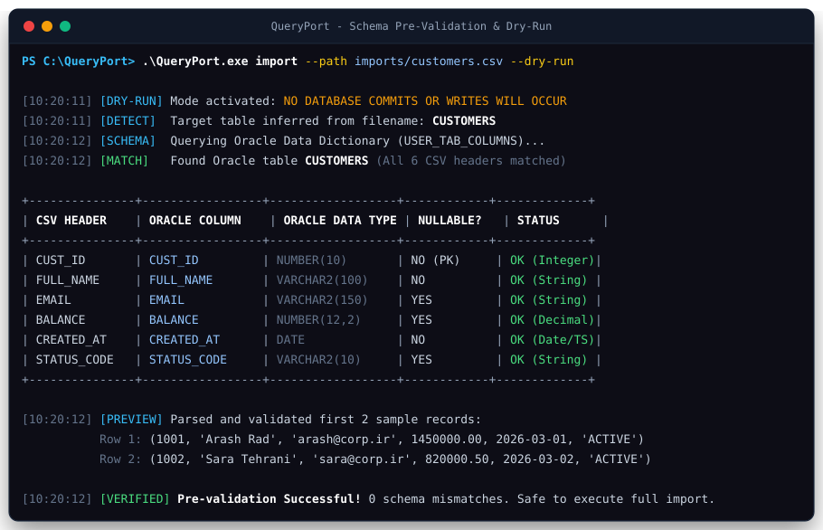
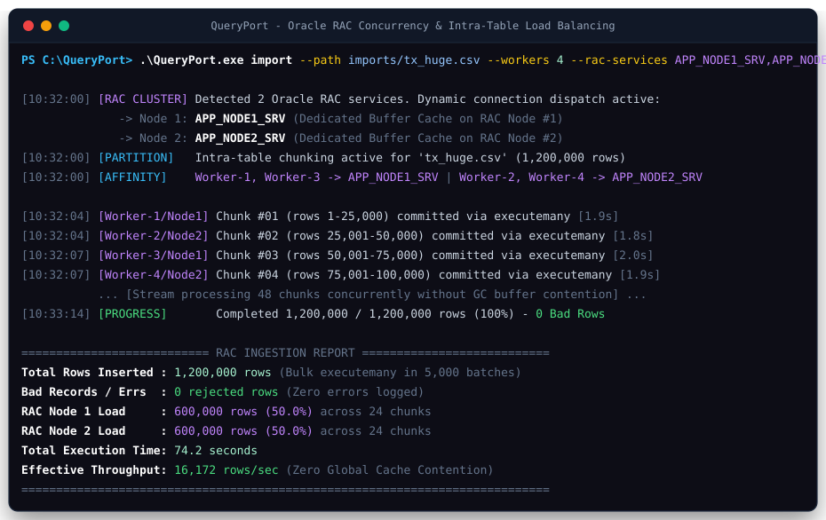

# 🖥️ راهنمای تصویری ترمینال و خط فرمان QueryPort
### QueryPort Visual Terminal & CLI Guide

این راهنما شامل شبیه‌سازی‌های بصری و تصاویر زنده از خروجی‌های ترمینال ابزار **QueryPort** در سناریوهای مختلف عملیاتی است تا به عنوان مرجع دیداری سریع برای مدیران دیتابیس (DBA)، معماران نرم‌افزار و توسعه‌دهندگان مورد استفاده قرار گیرد.

---

## 📑 فهرست راهنما

1. [سناریوی اول: اجرای تعاملی با دابل‌کلیک (Interactive Mode)](#۱-اجرای-تعاملی-با-دابلکلیک-interactive-mode)
2. [سناریوی دوم: استخراج چندفایلی و لاگ زنده استریمینگ (High-Throughput Export)](#۲-استخراج-موازی-دادهها-high-throughput-export)
3. [سناریوی سوم: اعتبارسنجی پیشگیرانه اسکیما و شبیه‌سازی (Dry-Run Pre-validation)](#۳-اعتبارسنجی-اسکیما-و-شبیهسازی-dry-run-pre-validation)
4. [سناریوی چهارم: همزمانی موازی سازمانی و توزیع بار روی کلاستر RAC](#۴-همزمانی-سازمانی-و-توزیع-بار-روی-نودهای-اوراکل-rac)
5. [جدول کلیدها و سوییچ‌های دستوری (CLI Flag Matrix)](#۵-جدول-سوییچهای-دستوری-cli-flag-matrix)

---

## ۱. اجرای تعاملی با دابل‌کلیک (Interactive Mode)

در این سناریو، کاربر بدون نیاز به باز کردن ترمینال یا تایپ دستور، مستقیماً روی فایل `QueryPort.exe` دابل‌کلیک می‌کند. برنامه اطلاعات دیتابیس و کلاستر را بررسی کرده و منوی تعاملی زیر را نمایش می‌دهد:



### 🔍 نکات کلیدی این نما:
* **بررسی خودکار اتصال Thin Mode:** بدون نیاز به تنظیم متغیرهای محیطی یا Instant Client.
* **تشخیص هوشمند نوع پایگاه داده:** نمایش نوع اتصال، تعداد نودهای کلاستر RAC و انکودینگ دیتابیس (`AL32UTF8`).
* **انتخاب مسیر با مقادیر پیش‌فرض کاربردی:** فشردن کلید Enter مقادیر بهینه پیش‌فرض را انتخاب می‌کند.

---

## ۲. استخراج پرسرعت داده‌ها (High-Throughput Export)

در صورتی که چندین فایل SQL در پوشه `sql_queries/` داشته باشید، می‌توانید با دستور زیر تمام آن‌ها را استخراج و همزمان به هر دو فرمت CSV و اسکریپت‌های INSERT سازگار با اوراکل تبدیل کنید:

```powershell
.\QueryPort.exe --path sql_queries --format both --batch-size 10000
```



### 🔍 پارامترهای استفاده‌شده:
* `--path sql_queries`: مسیر حاوی اسکریپت‌های `.sql`.
* `--format both`: تولید همزمان هر دو فایل استاندارد `.csv` و اسکریپت‌های استاندارد `INSERT` اوراکل.
* `--batch-size 10000`: تنظیم `arraysize` شبکه درایور اوراکل روی ۱۰,۰۰۰ سطر جهت کاهش مصرف رفت‌وبرگشت‌های شبکه (Network Round-trips).
* **استریمینگ پایدار:** مصرف حافظه رم (RAM) در تمام طول استخراج حتی برای صدها هزار رکورد زیر ۲۰ مگابایت ثابت باقی می‌ماند ($O(1)$).

---

## ۳. اعتبارسنجی اسکیما و شبیه‌سازی (Dry-Run Pre-validation)

قبل از دستکاری داده‌ها یا تزریق رکوردهای جدید در پایگاه داده‌های محیط عملیاتی (Production)، می‌توانید با سوییچ `--dry-run` از صحت کامل اسکیما و عدم وجود خطاهای ساختاری اطمینان حاصل کنید. در این حالت **هیچ کدی روی دیتابیس کامیت نمی‌شود**:

```powershell
.\QueryPort.exe import --path imports/customers.csv --dry-run
```



### 🔍 مزایای این مرحله:
* **استعلام متادیتای زنده:** خواندن دیکشنری داده‌های اوراکل (`USER_TAB_COLUMNS`).
* **جدول مقایسه بصری:** مقایسه دقیق ستون‌های فایل CSV با ستون‌های دیتابیس، نوع داده‌ها و قیود `NOT NULL`.
* **پیش‌نمایش نمونه رکوردها:** بررسی صحت تبدیل فرمت تاریخ‌ها، اعداد اعشاری و کاراکترهای رشته‌ای.

---

## ۴. همزمانی سازمانی و توزیع بار روی نودهای اوراکل RAC

برای ورود فایل‌های غول‌پیکر (چندمیلیون سطری) به دیتابیس‌های کلاستر Oracle RAC، با استفاده از سوییچ‌های زیر، فایل به صورت استریم و قطعه‌بندی‌شده خوانده شده و هر نود اوراکل از طریق سرویس مجزا هدایت می‌شود تا کش بافر دیتابیس قفل نشود:

```powershell
.\QueryPort.exe import --path imports/tx_huge.csv --workers 4 --rac-services APP_NODE1_SRV,APP_NODE2_SRV --intra-table --chunk-size 25000 --batch-size 5000
```



### 🔍 معماری توزیع بار RAC:
* `--rac-services APP_NODE1_SRV,APP_NODE2_SRV`: تعیین سرویس‌های مجزای نودهای RAC جهت تفکیک سشن‌ها (Affinity Routing).
* `--intra-table`: فعال‌سازی استریم قطعه‌بندی‌شده یک فایل بزرگ روی چند Worker موازی.
* `--chunk-size 25000`: سایز هر قطعه مستقل جهت پردازش در هر نوبت.
* **جلوگیری از Global Cache Contention:** ممانعت از ایجاد سربار تبادل بلوک بین نودها (Cache Fusion).

---

## ۵. جدول سوییچ‌های دستوری (CLI Flag Matrix)

| پارامتر خط فرمان | پیش‌فرض | نوع سناریو | شرح عملکرد |
| :--- | :---: | :---: | :--- |
| `(بدون پارامتر)` | - | تعاملی | اجرای ویزارد تعاملی مناسب کاربران عادی و کار با دابل‌کلیک |
| `--path <dir/file>` | `sql_queries` / `imports` | هر دو | تعیین مسیر فایل تکی یا پوشه حاوی چندین فایل |
| `--format <csv\|insert\|both>` | `both` | استخراج | فرمت خروجی فایل‌های ایجادشده |
| `--batch-size <int>` | `1000` / `5000` | هر دو | اندازه بافر واکشی در استخراج یا اندازه بسته `executemany` در ورود |
| `--workers <int>` | `1` | ورود | تعداد رشته‌های همزمان جهت پردازش موازی |
| `--dry-run` | `False` | هر دو | پیش‌نمایش و بررسی اسکیما بدون اعمال هیچ‌گونه تغییر در دیتابیس |
| `--rac-services <s1,s2>` | `None` | ورود | فهرست نام سرویس‌های RAC با کاما برای بالانس بار دوره‌ای (Round-Robin) |
| `--intra-table` | `False` | ورود | فعال‌سازی قطعه‌بندی استریم تک‌فایل بزرگ روی تردهای چندگانه |
| `--chunk-size <int>` | `25000` | ورود | تعداد سطرهای هر قطعه در پردازش `--intra-table` |
| `--existing-data <append\|truncate\|skip>` | `append` | ورود | خط‌مشی مواجهه با داده‌های قبلی موجود در جدول مقصد |
| `--on-error <abort\|skip_and_log>` | `abort` | ورود | خط‌مشی مواجهه با خطای یک رکورد خاص (توقف یا ثبت در لاگ و ادامه) |
| `--bad-rows-dir <dir>` | `import_errors` | ورود | پوشه ذخیره فایل‌های CSV حاوی رکوردهای رد شده و متن خطای اوراکل |

---

<div align="center">
  <b>طراحی و توسعه با بالاترین استاندارد مهندسی نرم‌افزار و پایگاه داده اوراکل</b><br>
  توسعه‌دهنده: <a href="https://github.com/hamid-morsali-786">hamid-morsali-786</a>
</div>
