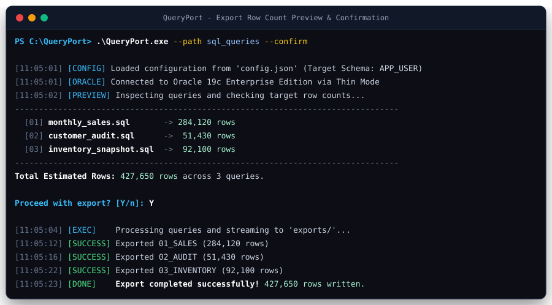
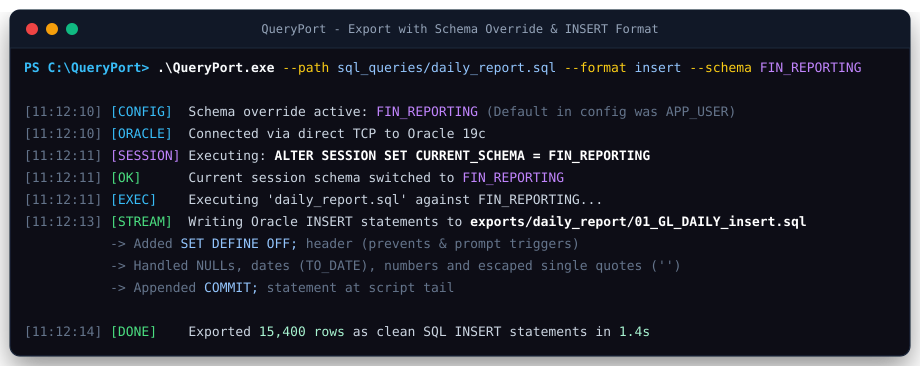
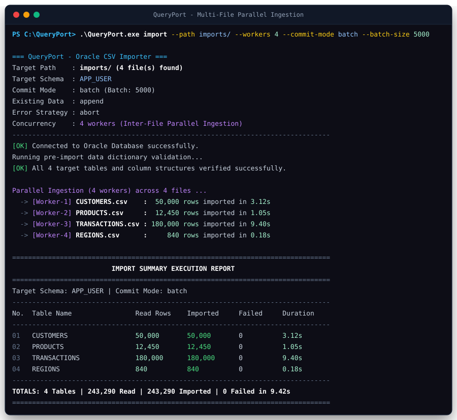
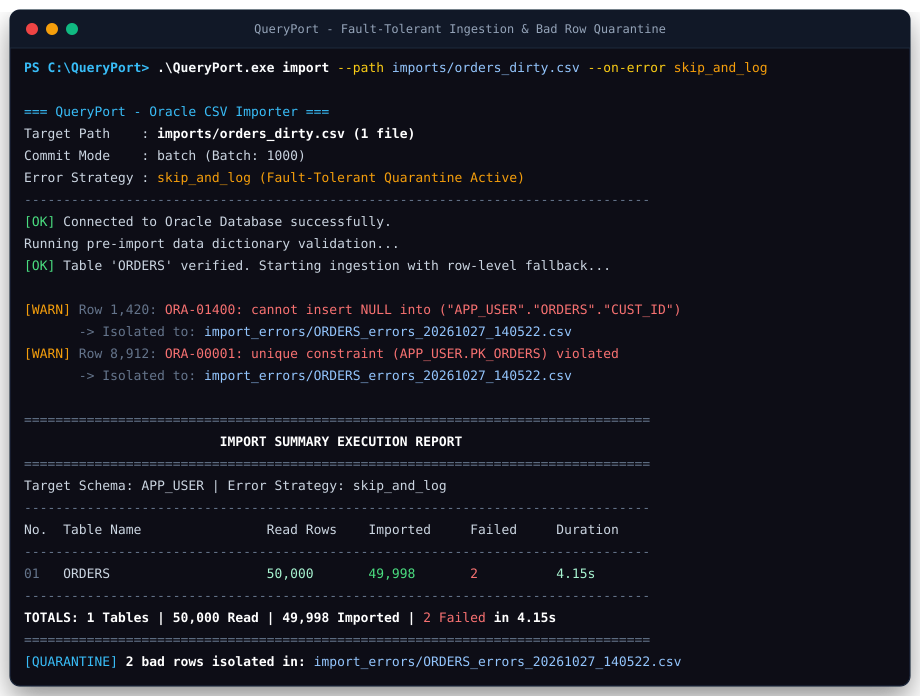
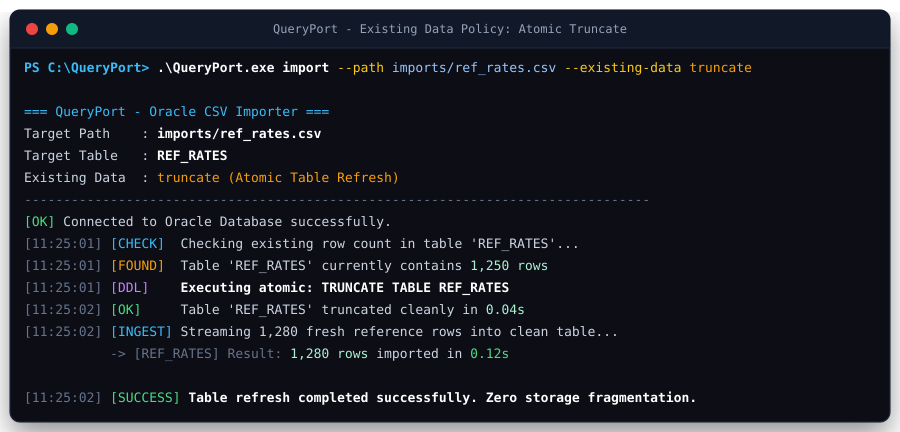
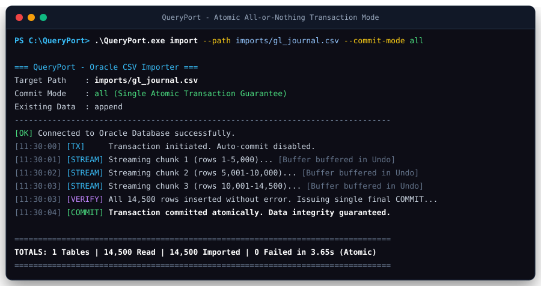
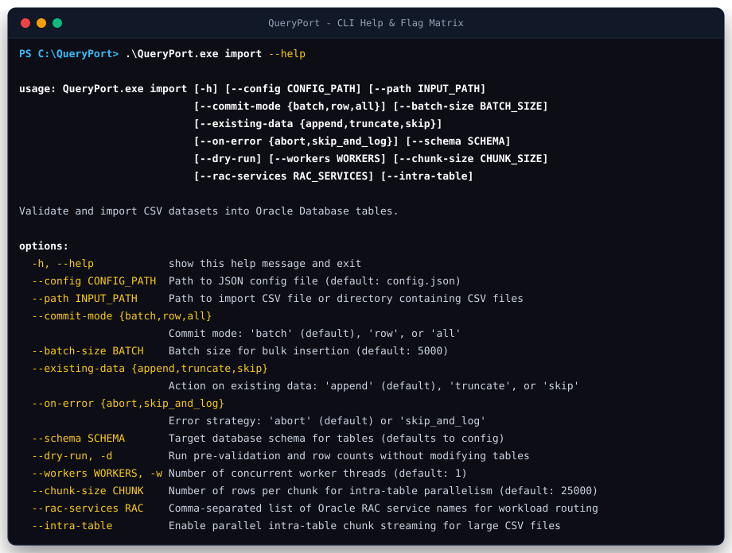

# 🖥️ راهنمای جامع تصویری ترمینال و خط فرمان QueryPort
### QueryPort Visual Terminal & Complete Scenario CLI Guide

این راهنما شامل شبیه‌سازی‌های بصری برداری (Crisp Vector SVG) و خروجی‌های واقعی ترمینال ابزار **QueryPort** در **تمامی سناریوهای قابل اجرا** در نرم‌افزار است. این مرجع دیداری کامل به مدیران دیتابیس (DBA)، معماران نرم‌افزار و توسعه‌دهندگان کمک می‌کند تا رفتار برنامه، گزینه‌ها و بازخوردهای خط فرمان را در هر سناریو مشاهده کنند.

---

## 📑 فهرست تمامی سناریوهای عملیاتی

1. [سناریوی اول: اجرای کنسول تعاملی یکپارچه (Interactive Console Mode)](#۱-اجرای-کنسول-تعاملی-یکپارچه-interactive-console-mode)
2. [سناریوی دوم: استخراج پرسرعت استریمینگ به CSV و INSERT (High-Throughput Export)](#۲-استخراج-پرسرعت-استریمینگ-به-csv-و-insert-high-throughput-export)
3. [سناریوی سوم: پیش‌نمایش تعداد سطرها و تایید قبل از استخراج (Export Dry-Run & Confirm)](#۳-پیشنمایش-تعداد-سطرها-و-تایید-قبل-از-استخراج-export-dry-run--confirm)
4. [سناریوی چهارم: استخراج با تغییر پویای اسکیما و فقط فرمت INSERT](#۴-استخراج-با-تغییر-پویای-اسکیما-و-فقط-فرمت-insert)
5. [سناریوی پنجم: اعتبارسنجی پیشگیرانه اسکیما و شبیه‌سازی صفر-ریسک (Import Dry-Run)](#۵-اعتبارسنجی-پیشگیرانه-اسکیما-و-شبیهسازی-صفر-ریسک-import-dry-run)
6. [سناریوی ششم: ورود موازی همزمان چندفایلی (Multi-File Parallel Ingestion)](#۶-ورود-موازی-همزمان-چندفایلی-multi-file-parallel-ingestion)
7. [سناریوی هفتم: قطعه‌بندی تک‌فایل بزرگ و توازن بار کلاستر اوراکل RAC](#۷-قطعهبندی-تکفایل-بزرگ-و-توازن-بار-کلاستر-اوراکل-rac)
8. [سناریوی هشتم: مدیریت خطای منعطف و قرنطینه رکوردهای نامعتبر (skip_and_log)](#۸-مدیریت-خطای-منعطف-و-قرنطینه-رکوردهای-نامعتبر-skip_and_log)
9. [سناریوی نهم: چرخه عمر جدول و پاک‌سازی داده‌های قبلی (Existing Data: Truncate / Skip)](#۹-چرخه-عمر-جدول-و-پاکسازی-دادههای-قبلی-existing-data-truncate--skip)
10. [سناریوی دهم: تراکنش‌های اتمیک یکپارچه و تک‌کامیت نهایی (Atomic 'commit-mode all')](#۱۰-تراکنشهای-اتمیک-یکپارچه-و-تککامیت-نهایی-atomic-commit-mode-all)
11. [سناریوی یازدهم: راهنمای خط فرمان و ماتریس سوییچ‌ها (CLI Help & Discoverability)](#۱۱-راهنمای-خط-فرمان-و-ماتریس-سوییچها-cli-help--discoverability)

---

## ۱. اجرای کنسول تعاملی یکپارچه (Interactive Console Mode)

در این سناریو، کاربر بدون هیچ سوییچی روی فایل `QueryPort.exe` دابل‌کلیک کرده یا آن را مستقیماً در ترمینال اجرا می‌کند. کنسول یکپارچه باز شده و کاربر می‌تواند بین استخراج (Export) یا ورود داده (Import) انتخاب کرده و پارامترها را مشخص نماید:

```powershell
.\QueryPort.exe
```


### 🔍 نکات کلیدی این نما:
* **حالت تعاملی ساده و کاربرپسند:** بدون نیاز به حفظ کردن دستورات و پرچم‌های CLI.
* **پشتیبانی کامل از کلیدهای Enter و مقادیر پیش‌فرض:** با زدن Enter، مقادیر استاندارد کانفیگ فراخوانی می‌شوند.
* **اجرای متوالی بدون خروج:** پس از اتمام یک عملیات، کنترل مجدداً به منوی اصلی بازمی‌گردد.

---

## ۲. استخراج پرسرعت استریمینگ به CSV و INSERT (High-Throughput Export)

در صورتی که چندین فایل SQL در یک پوشه داشته باشید، با این دستور تمامی آن‌ها به صورت جریانی (Streaming) بدون بارگذاری کل داده در رم ($O(1)$) استخراج و همزمان به هر دو فرمت CSV (با UTF-8 BOM) و اسکریپت INSERT تبدیل می‌شوند:

```powershell
.\QueryPort.exe --path sql_queries --format both --batch-size 10000
```


### 🔍 ویژگی‌های فنی:
* **تنظیم `arraysize` شبکه اوراکل:** سوییچ `--batch-size 10000` رفت‌وبرگشت‌های شبکه (Network Round-trips) را تا ۹۰٪ کاهش می‌دهد.
* **فرمت دوگانه (both):** تولید همزمان فایل CSV برای گزارش‌گیری اکسل و فایل `.sql` حاوی دستورات استاندارد INSERT برای اعمال مجدد روی دیتابیس دیگر.
* **مدیریت کاراکترهای یونیکد و فارسی:** فایل‌های CSV دارای BOM استاندارد (`\xef\xbb\xbf`) بوده و در Excel مستقیماً بدون به‌هم‌ریختگی حروف فارسی باز می‌شوند.

---

## ۳. پیش‌نمایش تعداد سطرها و تایید قبل از استخراج (Export Dry-Run & Confirm)

برای جلوگیری از استخراج ناخواسته جدول‌های غول‌پیکر سازمانی، سوییچ `--confirm` قبل از آغاز استخراج، تعداد سطرهای هر کوئری را از طریق `COUNT(*)` واکشی کرده و از کاربر تاییدیه می‌گیرد:

```powershell
.\QueryPort.exe --path sql_queries --confirm
```



### 🔍 مزایا برای مدیران دیتابیس:
* **مشاهده حجم قبل از اختصاص دیسک:** برآورد دقیق تعداد سطور و اندازه خروجی.
* **قابلیت انصراف ایمن:** کاربر می‌تواند با فشردن کلید `n` عملیات را بدون ایجاد فایل متوقف کند.
* **جایگزین `--dry-run`:** سوییچ `--dry-run` نیز صرفاً تعداد سطرها را نمایش داده و بلافاصله خارج می‌شود.

---

## ۴. استخراج با تغییر پویای اسکیما و فقط فرمت INSERT

در پایگاه داده‌های اوراکل سازمانی با چندین اسکیما (Multi-Schema)، می‌توانید بدون دستکاری فایل `config.json`، اسکیما را مستقیماً از طریق خط فرمان جابجا کرده و تنها اسکریپت استاندارد INSERT استخراج کنید:

```powershell
.\QueryPort.exe --path sql_queries/daily_report.sql --format insert --schema FIN_REPORTING
```



### 🔍 مشخصات خروجی اسکریپت INSERT:
* **دستور `SET DEFINE OFF;`:** جلوگیری از توقف اسکریپت در نرم‌افزارهای SQL Developer و SQLcl هنگام مواجهه با کاراکترهای `&`.
* **مدیریت مقادیر تهی و رشته‌های حساس:** تبدیل خودکار مقادیر `NULL` به کلمه کلیدی دیتابیس و Escape کردن تک‌کوتیشن‌ها (`''`).
* **تراکنش کامل با `COMMIT;`:** درج فرمان کامیت در انتهای فایل تولیدشده.

---

## ۵. اعتبارسنجی پیشگیرانه اسکیما و شبیه‌سازی صفر-ریسک (Import Dry-Run)

پیش از تزریق هرگونه رکورد به پایگاه داده عملیاتی، سوییچ `--dry-run` ساختار ستون‌های فایل CSV را با دیکشنری داده‌های اوراکل (`USER_TAB_COLUMNS`) مقایسه کرده و نمونه رکوردها را بدون اعمال تغییر نمایش می‌دهد:

```powershell
.\QueryPort.exe import --path imports/customers.csv --dry-run
```


### 🔍 مزایای پیش‌اعتبارسنجی:
* **تطبیق هدرهای فایل با ستون‌های دیتابیس:** شناسایی فوری ستون‌های ناشناخته یا عدم تطابق نام‌ها.
* **بررسی قیود `NOT NULL`:** هشدار در صورت عدم وجود ستون‌های الزامی فاقد مقدار پیش‌فرض (`DATA_DEFAULT`).
* **صفر ریسک (Zero Risk):** هیچ دستوری روی دیتابیس اجرا یا کامیت نمی‌شود.

---

## ۶. ورود موازی همزمان چندفایلی (Multi-File Parallel Ingestion)

هنگامی که چندین فایل CSV در یک دایرکتوری قرار دارند، می‌توانید با تخصیص چندین ترد کارگر (Worker Threads)، همه فایل‌ها را به صورت کاملاً موازی وارد جداول مقصد نمایید:

```powershell
.\QueryPort.exe import --path imports/ --workers 4 --commit-mode batch --batch-size 5000
```



### 🔍 مزایای این معماری:
* **سشن‌های مجزای دیتابیس:** هر Worker دارای کانکشن اختصاصی بدون رقابت روی یک اتصال است.
* **استفاده از `executemany`:** درج دسته‌ای رکوردهای ۵۰۰۰تایی با حداکثر بهره‌وری CPU و I/O.
* **گزارش آماری تجمیعی در پایان:** نمایش تعداد کل رکوردهای خوانده‌شده، واردشده و ناموفق به همراه زمان اجرای هر جدول.

---

## ۷. قطعه‌بندی تک‌فایل بزرگ و توازن بار کلاستر اوراکل RAC

برای فایل‌های فوق سنگین (چندمیلیون سطری)، سوییچ `--intra-table` به همراه تفکیک سرویس‌های Oracle RAC فعال می‌شود تا استریم فایل به قطعات مستقل (Chunks) تقسیم شده و به نودهای مختلف کلاستر هدایت شود:

```powershell
.\QueryPort.exe import --path imports/tx_huge.csv --workers 4 --rac-services APP_NODE1_SRV,APP_NODE2_SRV --intra-table --chunk-size 25000 --batch-size 5000
```


### 🔍 معماری توزیع بار در Oracle RAC:
* **Affinity Routing هوشمند:** اتصال تردها به صورت دوره‌ای (Round-Robin) به سرویس‌های مشخص‌شده RAC اختصاص می‌یابد.
* **رفع تداخل Global Cache Contention:** با تخصیص بلوک‌های اختصاصی، تبادل بلااستفاده بلوک‌ها بین نودهای کلاستر (Cache Fusion) به حداقل می‌رسد.
* **استریم خطی با صف کنترل‌شده:** فایل CSV به صورت قطعات ۲۵,۰۰۰ سطری بدون انفجار حافظه رم خوانده و مصرف می‌شود.

---

## ۸. مدیریت خطای منعطف و قرنطینه رکوردهای نامعتبر (skip_and_log)

در ورود داده‌های حجیم، بروز چند خطای جزئی (مانند نقض کلید اصلی یا مقدار خالی در ستون الزامی) نباید باعث لغو فرآیند ساعت‌ها ایمپورت شود. با استراتژی `skip_and_log`، رکوردهای معیوب جدا شده و در فایلی مستقل ثبت می‌شوند:

```powershell
.\QueryPort.exe import --path imports/orders_dirty.csv --on-error skip_and_log
```



### 🔍 مکانیزم قرنطینه:
* **تفکیک خودکار رکورد معیوب:** استخراج شماره سطر در فایل اصلی و متن خطای استاندارد اوراکل (نظیر `ORA-01400` یا `ORA-00001`).
* **لاگر Thread-Safe:** ثبت همزمان خطاها توسط تردهای مختلف در فایل `import_errors/<table>_errors_<timestamp>.csv` بدون قفل و خرابی فایل.
* **گزارش شفاف در جدول خلاصه:** درج دقیق تعداد رکوردهای واردشده و ناموفق در گزارش نهایی.

---

## ۹. چرخه عمر جدول و پاک‌سازی داده‌های قبلی (Existing Data: Truncate / Skip)

برای جداول اطلاعات پایه و پایه‌های ریفرنسی (Lookup Tables)، می‌توانید از خط‌مشی `truncate` جهت پاک‌سازی سریع جدول پیش از درج رکوردهای جدید استفاده کنید:

```powershell
.\QueryPort.exe import --path imports/ref_rates.csv --existing-data truncate
```



### 🔍 خط‌مشی‌های پشتیبانی‌شده:
* **`append` (پیش‌فرض):** افزودن سطرهای جدید به انتهای داده‌های فعلی جدول.
* **`truncate`:** اجرای فرمان سریع DDL جهت صفر کردن داده‌های جدول و ریست High-Water Mark بدون فرگمنتیشن ایندکس‌ها.
* **`skip`:** در صورتی که جدول دارای حتی یک سطر داده باشد، از فایل گذر کرده و داده‌های موجود دست‌نخورده باقی می‌مانند.

---

## ۱۰. تراکنش‌های اتمیک یکپارچه و تک‌کامیت نهایی (Atomic 'commit-mode all')

در تراکنش‌های حساس مالی، اسناد حسابداری یا لاگ‌های اعتباری که نباید داده به صورت ناقص وارد شود، مود `all` تضمین می‌کند که تمامی رکوردهای فایل در قالب یک تراکنش واحد ثبت و تنها پس از تایید آخرین سطر، فرمان `COMMIT` صادر شود:

```powershell
.\QueryPort.exe import --path imports/gl_journal.csv --commit-mode all
```



### 🔍 مقایسه مودهای Commit:
* **`batch` (پیش‌فرض):** صدور `COMMIT` در پایان هر بسته `batch-size`؛ مصرف متعادل Undo Tablespace و سرعت بسیار بالا.
* **`all`:** یک تراکنش واحد برای کل فایل؛ در صورت بروز خطا در سطر صدهزارم، تمامی ۹۹,۹۹۹ سطر قبلی به طور کامل Rollback می‌شوند.
* **`row`:** صدور کامیت سطر به سطر؛ کندترین حالت با بیشترین سربار دیسک Redo Log، اما مفید برای دیباگ دقیق.

---

## ۱۱. راهنمای خط فرمان و ماتریس سوییچ‌ها (CLI Help & Discoverability)

کاربران می‌توانند در هر زمان با اضافه کردن سوییچ `-h` یا `--help` لیست کامل پارامترها و مقادیر مجاز هر زیردستور را مشاهده کنند:

```powershell
.\QueryPort.exe import --help
```



---

## 📊 ماتریس مقایسه‌ای سوییچ‌های خط فرمان

| سوییچ خط فرمان | مقدار پیش‌فرض | زیردستور | شرح کامل عملکرد و کاربرد |
| :--- | :---: | :---: | :--- |
| `(بدون سوییچ)` | - | هر دو | ورود به کنسول تعاملی یکپارچه با راهنمای گام‌به‌گام |
| `--path <path>` | `sql_queries` / `imports` | هر دو | آدرس فایل منفرد یا پوشه حاوی چندین فایل ورودی |
| `--format <csv\|insert\|both>` | `both` | Export | فرمت تولید خروجی استخراج |
| `--batch-size <int>` | `1000` / `5000` | هر دو | اندازه بافر واکشی در استخراج یا بسته `executemany` در ورود |
| `--confirm` | `False` | Export | پیش‌نمایش تعداد سطرها و درخواست تایید پیش از شروع استخراج |
| `--dry-run` | `False` | هر دو | بررسی ساختار اسکیما و سطرها بدون هیچ‌گونه تغییر یا کامیت روی دیتابیس |
| `--schema <name>` | از کانفیگ | هر دو | تغییر سشن به اسکیما هدف با `ALTER SESSION SET CURRENT_SCHEMA` |
| `--workers <int>` | `1` | Import | تعداد تردهای کارگر موازی برای ورود همزمان فایل‌ها یا چانک‌ها |
| `--rac-services <s1,s2>` | `None` | Import | اسامی سرویس‌های مجزای Oracle RAC برای توازن بار چرخشی (Round-Robin) |
| `--intra-table` | `False` | Import | فعال‌سازی قطعه‌بندی موازی یک تک‌فایل بزرگ روی تردهای چندگانه |
| `--chunk-size <int>` | `25000` | Import | تعداد سطرهای هر قطعه مجزا در پردازش موازی تک‌فایل بزرگ |
| `--existing-data <append\|truncate\|skip>` | `append` | Import | نحوه مواجهه با داده‌های موجود پیش از ورود داده جدید |
| `--on-error <abort\|skip_and_log>` | `abort` | Import | استراتژی در برابر رکورد معیوب (توقف کامل یا قرنطینه در فایل لاگ) |
| `--config <path>` | `config.json` | هر دو | تعیین مسیر فایل پیکربندی سفارشی دیتابیس |

---

<div align="center">
  <b>طراحی و توسعه با بالاترین استانداردهای مهندسی نرم‌افزار، مقیاس‌پذیری و پایگاه داده اوراکل</b><br>
  توسعه‌دهنده: <a href="https://github.com/hamid-morsali-786">hamid-morsali-786</a>
</div>
